<!-- GENERATED FILE: edit templates/README.tpl.md, scripts/i18n.py and data/*.json, then run `python3 scripts/build.py`. -->
<div align="center">

<p>🌐 <a href="README.md"></a> <a href="README.es.md"></a> <a href="README.de.md"></a> <a href="README.it.md"></a> <a href="README.fr.md"></a> <a href="README.zh.md"></a> <a href="README.ar.md"></a> </p>


<a href="#about"></a>
<a href="#products"></a>
<a href="#radar"></a>
<a href="#building"></a>
<a href="#metrics"></a>
<a href="#connect"></a>

**أحوّل الأفكار إلى برمجيات.**<br>
تطبيقات · برامج سطح المكتب · منصات ويب · ذكاء اصطناعي وأتمتة — من الفكرة إلى الإطلاق.

<sub><i>فحصتُ حامات ومحركات طائرات وصواريخ. والآن أفحص الشيفرة.</i></sub>

<br><br>


</div>

<div dir="rtl">

<a id="about"></a>
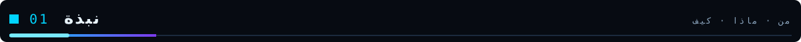

<table>
<tr>
<td width="260" valign="top" align="center">


</td>
<td valign="top">

أنا مطوّر برمجيات مستقل وصانع منتجات. لا أسلّم ميزات منفردة، بل **منتجات متكاملة**: الفكرة والواجهة والتطبيق والخادم والتكاملات والاختبار والتوثيق والإطلاق.

خلفيتي هي الجودة بمعايير الطيران والفضاء: اختبارات غير إتلافية منذ 2007، و**PLD Space** (Miura 1)، وتدقيق في **Bureau Veritas**، و**SR Technics** — ولذلك أعمل بعقلية *عدم التسامح*: تتبّع وتحقق ونتائج قابلة للتكرار.

</td>
</tr>
</table>

<table>
<tr>
<td width="50%" valign="top">

**ما أبنيه**

- تطبيقات الجوال (iOS · Android)
- برامج سطح المكتب (macOS · Windows)
- منصات الويب
- أدوات الذكاء الاصطناعي والوكلاء الصوتيون
- الأتمتة والأنظمة البرمجية المتكاملة

</td>
<td width="50%" valign="top">

**كيف أعمل**

`فكّر ← صمّم ← ابنِ ← اختبر ← انشر ← حسّن`

مستقل وموثّق ومُنجَز. أتعلم من خلال بناء منتجات حقيقية.

</td>
</tr>
</table>

<details open>
<summary><b>🧬 من مفتش اختبارات غير إتلافية إلى صانع برمجيات — طريقي</b></summary>

<br>

<div align="center">


<br>

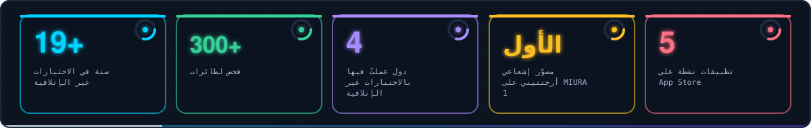

</div>

الاختبارات غير الإتلافية هي حرفتي منذ 2007: حامات ومحركات طائرات وهياكل صواريخ، في الأرجنتين وإسبانيا وسويسرا. في **PLD Space** عملت على **Miura 1** — أول صاروخ مصنَّع محليًا في إسبانيا — وكنت أول مصوّر إشعاعي أرجنتيني يجري عليه الفحص الإشعاعي. وفي **SR Technics** نفّذت **أكثر من 300 فحص لمكونات طائرات حرجة**. قبل نحو عام بدأت الانتقال إلى البرمجيات: تعلّمت Swift وSwiftUI بنفسي ونشرت **ENODEUS**، تطبيق iOS أصلي يؤتمت أعمال الفحص التي كنت أنجزها يدويًا. الانضباط نفسه، والمادة جديدة.

- خبرة ميدانية في VT وPT وMT وRT وUT في الطيران والطاقة والتصنيع
- العمل وفق متطلبات EASA وEN 4179 وISO 9001 وASME: تقارير وحالات عدم مطابقة وتحليل جذور وتدقيق
- الآن: Swift وSwiftUI وFirebase والامتثال لمتطلبات App Store — عادات إطلاق منتج حقيقي

<div align="center">

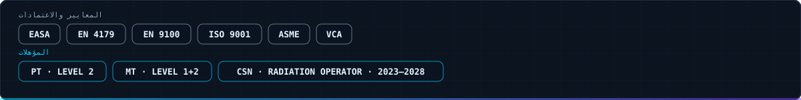

<br><br>


</div>

<sub>PT = السوائل المتخللة · MT = الجسيمات المغناطيسية · VT = بصري · RT = التصوير الإشعاعي</sub>

<div align="center">

<table>
<tr>
<td width="33%"></td>
<td width="33%"></td>
<td width="33%"></td>
</tr>
</table>

<sub>SR Technics، زيورخ: فحص بالسوائل المتخللة الفلورية لمكوّن محرك، وقاعة المحركات، وخط FPI.</sub>

<table>
<tr>
<td width="25%"></td>
<td width="25%"></td>
<td width="25%"></td>
<td width="25%"></td>
</tr>
</table>

<sub>صور من فترة عملي في PLD Space: فحص جزء من خزان، والورشة، وإطلاق صاروخ.</sub>

</div>

</details>

<details open>
<summary><b>🌐 منظومة Island Crew — المواهب، المكتب الذكي، المطاعم، الأكاديمية، الإعلام</b></summary>

<br>

<div align="center">


<sub>منظومة واحدة للأشخاص والأعمال والابتكار في جزر الكناري — يدير Maxi OS مكتبًا ذكيًا من 60 وكيلًا في 16 قسمًا.</sub>

</div>

</details>


<a id="products"></a>
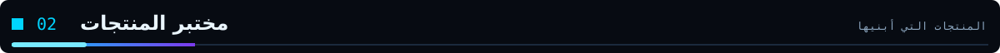

<div align="center">

<table>
<tr>
<td width="50%" valign="top">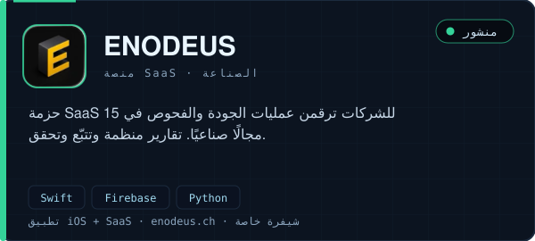<br><a href="https://enodeus.ch"><b>افتح Enodeus ←</b></a></td>
<td width="50%" valign="top">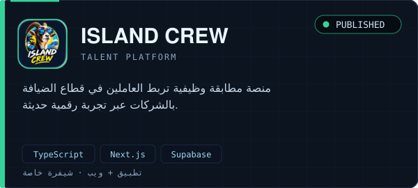<br><a href="https://islandcrew.es"><b>افتح Island Crew ←</b></a></td>
</tr>
<tr>
<td width="50%" valign="top">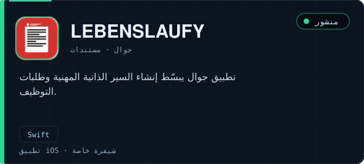<br><a href="https://lebenslaufy.com"><b>افتح Lebenslaufy ←</b></a></td>
<td width="50%" valign="top">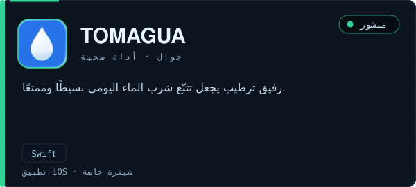<br><sub>شيفرة خاصة</sub></td>
</tr>
<tr>
<td width="50%" valign="top">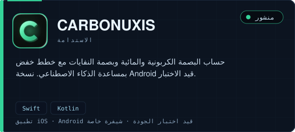<br><sub>شيفرة خاصة</sub></td>
<td width="50%" valign="top">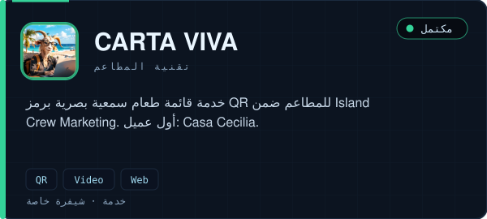<br><sub>شيفرة خاصة</sub></td>
</tr>
<tr>
<td width="50%" valign="top">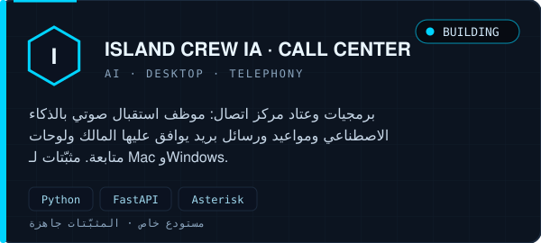<br><sub>شيفرة خاصة</sub></td>
</tr>
</table>

<details open>
<summary><b>📱 على App Store — تطبيقاتي المنشورة لـ iPhone وiPad</b></summary>

<br>


</details>

<sub>تسميات الحالة صادقة: مصدرها <code>data/projects.json</code>. «شيفرة خاصة» تعني أن المنتج موجود لكن الشيفرة غير عامة.</sub>

</div>

<a id="radar"></a>
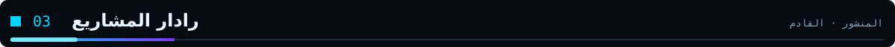

<div align="center">


</div>


<a id="building"></a>
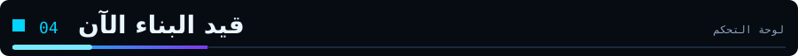

<div align="center">


</div>

**Island Crew IA — برمجيات وعتاد مركز الاتصال.** سنترال هاتفي مع موظف استقبال صوتي بالذكاء الاصطناعي: يرد على المكالمات، ويحجز المواعيد، ويصيغ رسائل بريد للعملاء يوافق عليها المالك، ويرفع التقارير عبر لوحات المتابعة. مثبّتات لنظامي macOS وWindows.

<details>
<summary><b>📸 معرض السنترال — الواجهة ومفهوم العتاد والتسويق</b></summary>

<br>

<div align="center">


<table>
<tr>
<td width="50%">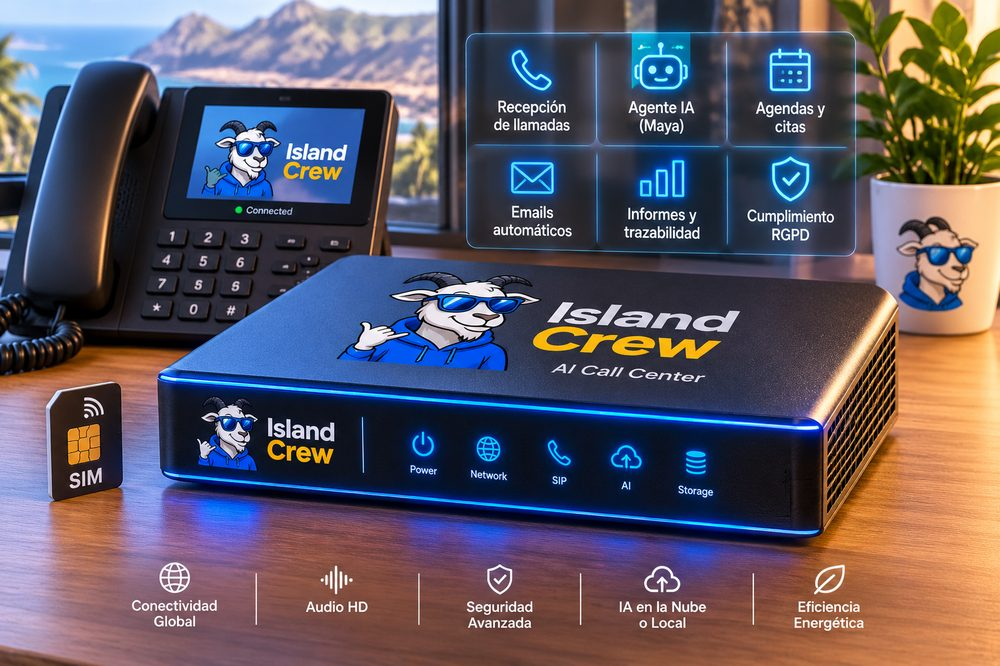</td>
<td width="50%"></td>
</tr>
<tr>
<td colspan="2"></td>
</tr>
</table>

<sub>صور العتاد والتسويق مفاهيم تصميمية؛ الواجهة هي البرنامج العامل فعليًا.</sub>

</div>

</details>

<details>
<summary><b>⚡ مجالات الاستكشاف وخارطة الطريق</b></summary>

<br>

| المجال | الاتجاه |
|---|---|
| الجوال | تطوير التطبيقات المنشورة؛ Carbonuxis Android قيد اختبار الجودة |
| سطح المكتب | برمجيات متعددة المنصات قابلة للتنزيل بمثبّت بنقرة واحدة |
| الذكاء الاصطناعي | تكاملات مفيدة وحقيقية: وكلاء صوتيون وملخصات وجدولة |
| الأتمتة | إزالة العمل المتكرر مع بقاء شخص يوافق على المهم |
| البنية التحتية | الموثوقية والعمارة وأتمتة الإصدارات |

</details>

<a id="pipeline"></a>
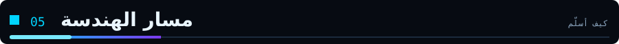

<div align="center">


</div>

<details>
<summary><b>▸ المسار كمخطط (Mermaid)</b></summary>

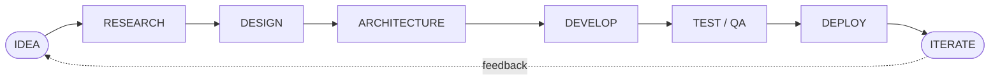

</details>

<details>
<summary><b>▸ مبادئ الهندسة</b></summary>

<br>

- **تحقّق ولا تفترض.** كل ادعاء يُختبر قبل أن أعلن إنجازه.
- **التتبّع.** من عالم الاختبارات غير الإتلافية: كل مخرَج يمكن تتبّعه إلى مصدره.
- **الإنسان في الحلقة.** الأتمتة تقترح، والمالك يوافق على ما يخرج.
- **أطلق قليلًا وبصدق.** إصدار يعمل أفضل من خطة مثالية.

</details>

<a id="stack"></a>
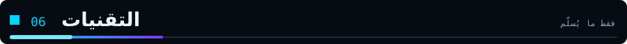

<div align="center">


</div>

<details>
<summary><b>▸ التقنيات كأيقونات</b></summary>

<br>

<div align="center">

<br>
<br>


</div>

</details>

<div align="center">

<sub>فقط التقنيات الموجودة في مستودعاتي الفعلية.</sub>

</div>

<a id="metrics"></a>
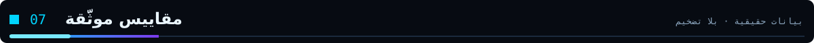

<div align="center">

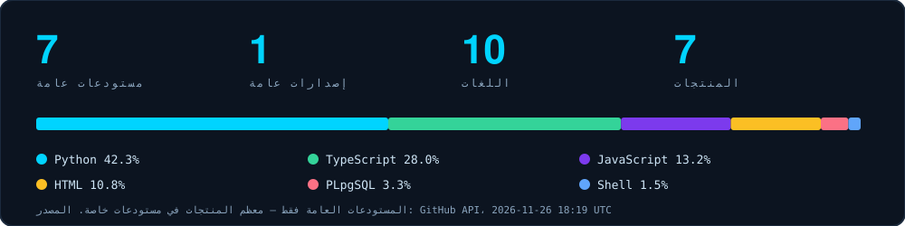

<picture><source media="(prefers-color-scheme: dark)" srcset="assets/generated/snake-dark.svg"></picture>

</div>

<details>
<summary><b>📦 المستودعات العامة (تُولَّد تلقائيًا)</b></summary>

<br>

| Repository | What it is | Language | Latest release | Updated |
|---|---|---|---|---|
| [`island-crew-downloads`](https://github.com/MAXIMILIANOGROSS/island-crew-downloads) | island-crew-downloads | HTML | [island-crew-suite-v1.0.0-macos-arm64](https://github.com/MAXIMILIANOGROSS/island-crew-downloads/releases/tag/island-crew-suite-v1.0.0-macos-arm64) | 2026-11-23 |
| [`islandcrewsuite`](https://github.com/MAXIMILIANOGROSS/islandcrewsuite) | suite marketing | Python | — | 2026-11-15 |
| [`meeting-booker-repo`](https://github.com/MAXIMILIANOGROSS/meeting-booker-repo) | — | JavaScript | — | 2026-11-01 |
| [`MyBrain`](https://github.com/MAXIMILIANOGROSS/MyBrain) | Your second self: observes real data, proposes one action a day, waits for your approval, and learns. Free, MIT | TypeScript | — | 2026-10-28 |
| [`virtual-office`](https://github.com/MAXIMILIANOGROSS/virtual-office) | Oficina virtual 3D con 43 agentes de IA. Plantilla en blanco, Next.js + Supabase. | TypeScript | — | 2026-10-23 |
| [`carbon-is-android`](https://github.com/MAXIMILIANOGROSS/carbon-is-android) | carbonáis para android | — | — | 2026-09-24 |
| [`island-crew-legal`](https://github.com/MAXIMILIANOGROSS/island-crew-legal) | — | — | — | 2026-09-21 |

<sub>آخر تحديث بواسطة GitHub Actions: 2026-11-26 18:19 UTC</sub>

</details>

<a id="lab"></a>
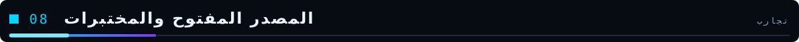

| المشروع | الحالة | ما هو | |
|---|---|---|---|
| **ENODEUS** | `منصة SaaS` | حزمة SaaS للشركات: ترقمن العمليات وفحوص الجودة في 15 مجالًا صناعيًا. | [الموقع](https://enodeus.ch) |
| **MyBrain** | `مفتوح المصدر · MIT` | ذات ثانية: تراقب البيانات الحقيقية وتقترح إجراءً واحدًا يوميًا وتنتظر الموافقة وتتعلم. | [المستودع](https://github.com/MAXIMILIANOGROSS/MyBrain) |
| **Virtual Office** | `مفتوح المصدر` | مكتب افتراضي ثلاثي الأبعاد بـ 43 وكيل ذكاء اصطناعي. قالب فارغ على Next.js + Supabase. | [المستودع](https://github.com/MAXIMILIANOGROSS/virtual-office) |
| **Island Crew Suite** | `إصدار` | حزمة تسويق ذاتية التثبيت لنظامي Mac وWindows للمطاعم. التنزيلات منشورة كإصدارات. | [المستودع](https://github.com/MAXIMILIANOGROSS/island-crew-downloads) |

<details>
<summary><b>🎧 ما وراء البرمجيات</b></summary>

<br>

<div align="center">

  

</div>

إنتاج موسيقي وتصميم صوتي ومفاهيم بصرية وهوية — ومنها **Cabra Beats**، أداة لإنشاء الموسيقى بمساعدة الذكاء الاصطناعي لأغاني وجينغلات الأعمال. تفكير تقني مقرون بالإبداع.

<a href="https://www.youtube.com/@IslandCrewYT"></a> <sub>قناة آلية — أغانٍ وجينغلات تنشرها Cabra Beats.</sub>

</details>

<details>
<summary><code>sudo reveal_more</code></summary>

<br>

```text
[sudo] password for maximiliano: ********
Access granted.

> This profile is generated by its own scripts (scripts/build.py).
> Every number above is pulled from the GitHub API — or it isn't shown.
> Fun fact: the radar sweeps once every 12 seconds. Nobody asked, it just felt right.
> The next build is already running. Check back soon.
```

</details>

<a id="connect"></a>
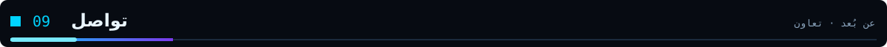

<div align="center">

**هل تود أن نبني شيئًا ذا قيمة معًا؟**<br>
منفتح على فرص العمل عن بُعد والتعاون البرمجي والمشاريع المثيرة — اليونان / الاتحاد الأوروبي.

<a href="https://www.linkedin.com/in/maximiliano-olmos-sanchez"></a>
<a href="https://github.com/MAXIMILIANOGROSS"></a>
<a href="https://enodeus.ch"></a>
<a href="https://islandcrew.es"></a>
<a href="https://www.youtube.com/@IslandCrewYT"></a>
<a href="https://lebenslaufy.com"></a>

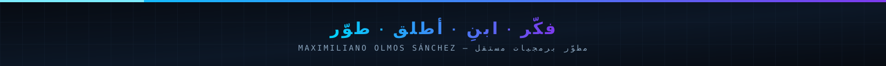

</div>

</div>
