<!-- GENERATED FILE: edit templates/README.tpl.md, scripts/i18n.py and data/*.json, then run `python3 scripts/build.py`. -->
<div align="center">

<p>🌐 <a href="README.md"></a> <a href="README.es.md"></a> <a href="README.de.md"></a> <a href="README.it.md"></a> <a href="README.fr.md"></a> <a href="README.zh.md"></a> <a href="README.ar.md"></a> </p>


<a href="#about"></a>
<a href="#products"></a>
<a href="#radar"></a>
<a href="#building"></a>
<a href="#metrics"></a>
<a href="#connect"></a>

**Ich verwandle Ideen in Software.**<br>
Apps · Desktop-Software · Webplattformen · KI & Automatisierung — vom Konzept bis zum Einsatz.

<sub><i>Ich habe Schweißnähte, Flugzeugtriebwerke und Raketen geprüft. Jetzt prüfe ich Code.</i></sub>

<br><br>


</div>


<a id="about"></a>
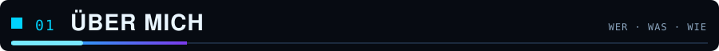

<table>
<tr>
<td width="260" valign="top" align="center">

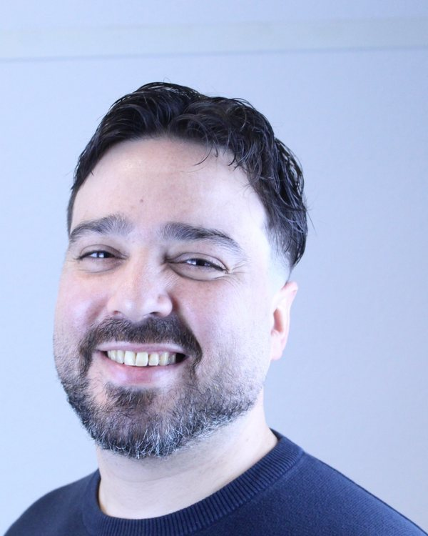

</td>
<td valign="top">

Ich bin unabhängiger Softwareentwickler und Produktbauer. Ich liefere keine Einzelfunktionen, sondern **komplette Produkte**: Idee, Oberfläche, Anwendung, Backend, Integrationen, Tests, Dokumentation und Release.

Mein Hintergrund ist Qualität auf Luft- und Raumfahrtniveau: ZfP seit 2007, **PLD Space** (Miura 1), Audits bei **Bureau Veritas** und **SR Technics** — deshalb arbeite ich mit einer *Null-Toleranz*-Haltung: Rückverfolgbarkeit, Verifikation, reproduzierbare Ergebnisse.

</td>
</tr>
</table>

<table>
<tr>
<td width="50%" valign="top">

**WAS ICH BAUE**

- Mobile Apps (iOS · Android)
- Desktop-Software (macOS · Windows)
- Webplattformen
- KI-Werkzeuge & Sprachagenten
- Automatisierung & Software-Ökosysteme

</td>
<td width="50%" valign="top">

**WIE ICH ARBEITE**

`Denken → Entwerfen → Bauen → Testen → Ausliefern → Verbessern`

Unabhängig, dokumentiert, ausgeliefert. Ich lerne, indem ich echte Produkte baue.

</td>
</tr>
</table>

<details open>
<summary><b>🧬 Vom ZfP-Prüfer zum Softwarebauer — mein Weg</b></summary>

<br>

<div align="center">


<br>

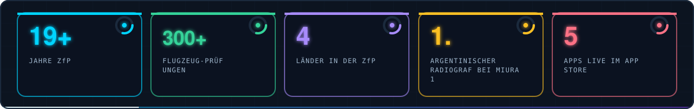

</div>

Die ZfP ist seit 2007 mein Handwerk: Schweißnähte, Flugzeugtriebwerke und Raketenstrukturen, in Argentinien, Spanien und der Schweiz. Bei **PLD Space** arbeitete ich an **Miura 1** — Spaniens erster im Land gebauter Rakete — und war der erste argentinische Radiograf, der sie durchleuchtete. Bei **SR Technics** führte ich **über 300 Prüfungen an kritischen Flugzeugbauteilen** durch. Vor etwa einem Jahr begann ich den Wechsel zur Software: Ich brachte mir Swift und SwiftUI selbst bei und veröffentlichte **ENODEUS**, eine native iOS-App, die Prüfarbeit automatisiert, die ich früher von Hand erledigte. Gleiche Disziplin, neues Material.

- Praxis in VT, PT, MT, RT und UT in Luftfahrt, Energie und Fertigung
- Arbeit nach EASA, EN 4179, ISO 9001 und ASME: Berichte, Abweichungen, Ursachenanalyse, Audits
- Jetzt: Swift, SwiftUI, Firebase und App-Store-Konformität — die Gewohnheiten, ein echtes Produkt auszuliefern

<div align="center">

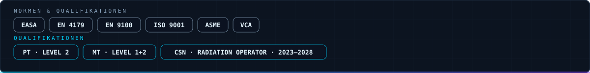

<br><br>


</div>

<sub>PT = Eindringprüfung · MT = Magnetpulver · VT = Sichtprüfung · RT = Durchstrahlung</sub>

<div align="center">

<table>
<tr>
<td width="33%"></td>
<td width="33%"></td>
<td width="33%"></td>
</tr>
</table>

<sub>SR Technics, Zürich: Fluoreszenz-Eindringprüfung eines Triebwerksbauteils, die Triebwerkshalle und die FPI-Linie.</sub>

<table>
<tr>
<td width="25%"></td>
<td width="25%">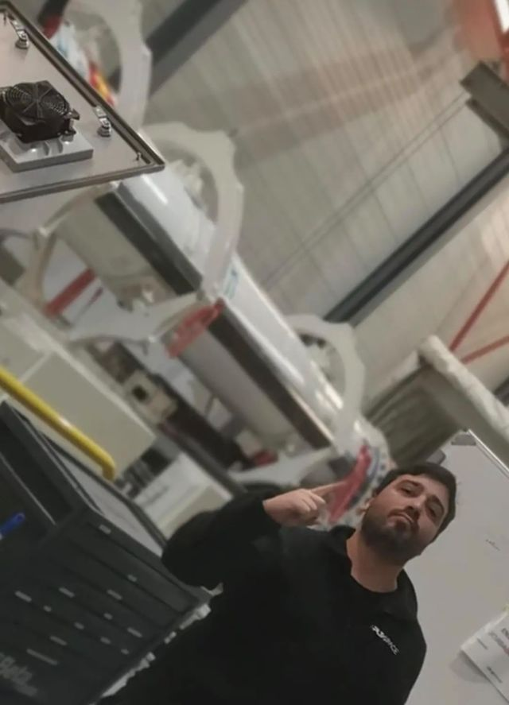</td>
<td width="25%"></td>
<td width="25%"></td>
</tr>
</table>

<sub>Fotos aus meiner Zeit bei PLD Space: Prüfung eines Tankabschnitts, die Werkstatt und ein Raketenstart.</sub>

</div>

</details>

<details open>
<summary><b>🌐 Das Island-Crew-Ökosystem — Talente, KI-Büro, Restaurants, Akademie, Medien</b></summary>

<br>

<div align="center">


<sub>Ein Ökosystem für Menschen, Unternehmen und Innovation auf den Kanaren — Maxi OS koordiniert ein KI-Büro mit 60 Agenten in 16 Abteilungen.</sub>

</div>

</details>


<a id="products"></a>
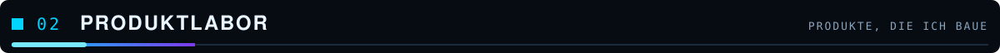

<div align="center">

<table>
<tr>
<td width="50%" valign="top">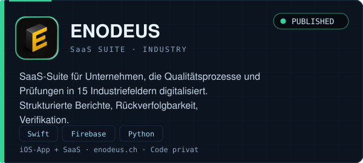<br><a href="https://enodeus.ch"><b>Enodeus öffnen →</b></a></td>
<td width="50%" valign="top">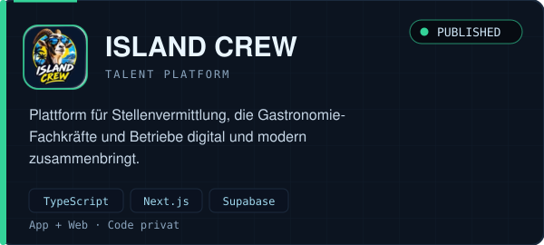<br><a href="https://islandcrew.es"><b>Island Crew öffnen →</b></a></td>
</tr>
<tr>
<td width="50%" valign="top">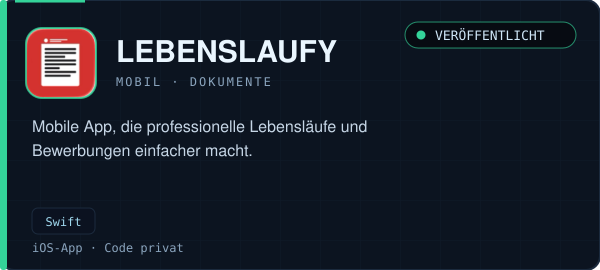<br><a href="https://lebenslaufy.com"><b>Lebenslaufy öffnen →</b></a></td>
<td width="50%" valign="top">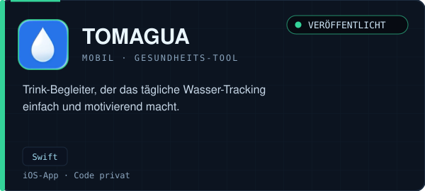<br><sub>privater Code</sub></td>
</tr>
<tr>
<td width="50%" valign="top">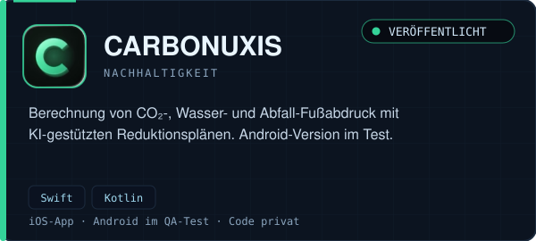<br><sub>privater Code</sub></td>
<td width="50%" valign="top">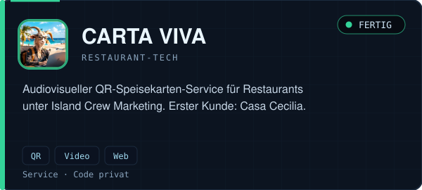<br><sub>privater Code</sub></td>
</tr>
<tr>
<td width="50%" valign="top">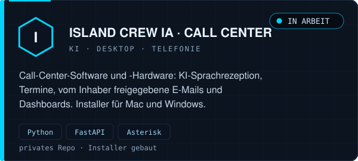<br><sub>privater Code</sub></td>
</tr>
</table>

<details open>
<summary><b>📱 Im App Store — meine veröffentlichten iPhone- & iPad-Apps</b></summary>

<br>


</details>

<sub>Die Statusangaben sind ehrlich: Sie stammen aus <code>data/projects.json</code>. „Privater Code“ heißt: Das Produkt existiert, der Quellcode ist nicht öffentlich.</sub>

</div>

<a id="radar"></a>


<div align="center">


</div>


<a id="building"></a>
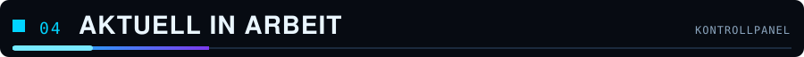

<div align="center">


</div>

**Island Crew IA — Call Center Software & Hardware.** Eine Telefonanlage mit KI-Sprachrezeption: Sie nimmt Anrufe an, bucht Termine, entwirft Kunden-E-Mails, die der Inhaber freigibt, und berichtet über Dashboards. Installer für macOS und Windows.

<details>
<summary><b>📸 Galerie der Telefonanlage — Oberfläche, Hardware-Konzept & Marketing</b></summary>

<br>

<div align="center">


<table>
<tr>
<td width="50%"></td>
<td width="50%"></td>
</tr>
<tr>
<td colspan="2"></td>
</tr>
</table>

<sub>Hardware- und Marketingbilder sind Designkonzepte; die Oberfläche ist die funktionierende Software.</sub>

</div>

</details>

<details>
<summary><b>⚡ Erkundungsfelder & Roadmap</b></summary>

<br>

| Bereich | Richtung |
|---|---|
| Mobil | Veröffentlichte Apps weiterentwickeln; Carbonuxis Android im QA-Test |
| Desktop | Herunterladbare plattformübergreifende Software mit Ein-Klick-Installern |
| KI | Nützliche, echte Integrationen: Sprachagenten, Zusammenfassungen, Terminplanung |
| Automatisierung | Wiederkehrende Arbeit entfernen, ein Mensch gibt Wichtiges frei |
| Infrastruktur | Zuverlässigkeit, Architektur, Release-Automatisierung |

</details>

<a id="pipeline"></a>
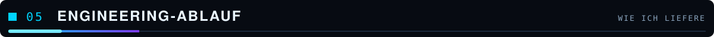

<div align="center">


</div>

<details>
<summary><b>▸ Ablauf als Diagramm (Mermaid)</b></summary>

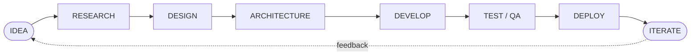

</details>

<details>
<summary><b>▸ Engineering-Prinzipien</b></summary>

<br>

- **Prüfen statt annehmen.** Jede Aussage wird getestet, bevor ich sie als erledigt melde.
- **Rückverfolgbarkeit.** Aus der ZfP-Welt: Jedes Ergebnis lässt sich bis zur Quelle zurückverfolgen.
- **Mensch im Loop.** Die Automatisierung schlägt vor; der Inhaber gibt frei, was das Haus verlässt.
- **Klein und echt ausliefern.** Ein funktionierendes Release schlägt einen perfekten Plan.

</details>

<a id="stack"></a>
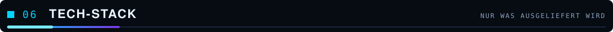

<div align="center">


</div>

<details>
<summary><b>▸ Stack als Icons</b></summary>

<br>

<div align="center">

<br>
<br>


</div>

</details>

<div align="center">

<sub>Nur Technologien, die in meinen echten Repositories vorkommen.</sub>

</div>

<a id="metrics"></a>
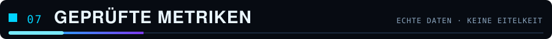

<div align="center">

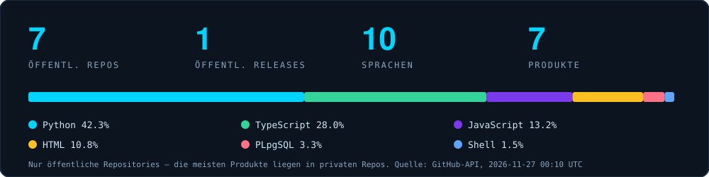

<picture><source media="(prefers-color-scheme: dark)" srcset="assets/generated/snake-dark.svg"></picture>

</div>

<details>
<summary><b>📦 Öffentliche Repositories (automatisch erzeugt)</b></summary>

<br>

| Repository | What it is | Language | Latest release | Updated |
|---|---|---|---|---|
| [`island-crew-downloads`](https://github.com/MAXIMILIANOGROSS/island-crew-downloads) | island-crew-downloads | HTML | [island-crew-suite-v1.0.0-macos-arm64](https://github.com/MAXIMILIANOGROSS/island-crew-downloads/releases/tag/island-crew-suite-v1.0.0-macos-arm64) | 2026-11-23 |
| [`islandcrewsuite`](https://github.com/MAXIMILIANOGROSS/islandcrewsuite) | suite marketing | Python | — | 2026-11-15 |
| [`meeting-booker-repo`](https://github.com/MAXIMILIANOGROSS/meeting-booker-repo) | — | JavaScript | — | 2026-11-01 |
| [`MyBrain`](https://github.com/MAXIMILIANOGROSS/MyBrain) | Your second self: observes real data, proposes one action a day, waits for your approval, and learns. Free, MIT | TypeScript | — | 2026-10-28 |
| [`virtual-office`](https://github.com/MAXIMILIANOGROSS/virtual-office) | Oficina virtual 3D con 43 agentes de IA. Plantilla en blanco, Next.js + Supabase. | TypeScript | — | 2026-10-23 |
| [`carbon-is-android`](https://github.com/MAXIMILIANOGROSS/carbon-is-android) | carbonáis para android | — | — | 2026-09-24 |
| [`island-crew-legal`](https://github.com/MAXIMILIANOGROSS/island-crew-legal) | — | — | — | 2026-09-21 |

<sub>Zuletzt aktualisiert durch GitHub Actions: 2026-11-26 19:16 UTC</sub>

</details>

<a id="lab"></a>
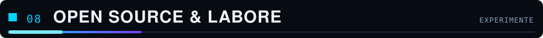

| Projekt | Status | Was es ist | |
|---|---|---|---|
| **ENODEUS** | `SaaS-SUITE` | SaaS-Suite für Unternehmen: digitalisiert Prozesse und Qualitätsprüfungen für 15 Industriefelder. | [Website](https://enodeus.ch) |
| **MyBrain** | `OPEN SOURCE · MIT` | Ein zweites Ich: beobachtet echte Daten, schlägt täglich eine Aktion vor, wartet auf Freigabe, lernt. | [Repo](https://github.com/MAXIMILIANOGROSS/MyBrain) |
| **Virtual Office** | `OPEN SOURCE` | 3D-Virtualbüro mit 43 KI-Agenten. Leere Vorlage auf Next.js + Supabase. | [Repo](https://github.com/MAXIMILIANOGROSS/virtual-office) |
| **Island Crew Suite** | `RELEASE` | Selbstinstallierende Marketing-Suite für Mac / Windows für Restaurants. Downloads als Releases. | [Repo](https://github.com/MAXIMILIANOGROSS/island-crew-downloads) |

<details>
<summary><b>🎧 Jenseits der Software</b></summary>

<br>

<div align="center">

  

</div>

Musikproduktion, Sounddesign, visuelle Konzepte und Branding — darunter **Cabra Beats**, ein KI-gestütztes Musikwerkzeug für Jingles und Songs von Unternehmen. Technisches Denken trifft Kreativität.

<a href="https://www.youtube.com/@IslandCrewYT"></a> <sub>Automatisierter Kanal — von Cabra Beats veröffentlichte Songs und Jingles.</sub>

</details>

<details>
<summary><code>sudo reveal_more</code></summary>

<br>

```text
[sudo] password for maximiliano: ********
Access granted.

> This profile is generated by its own scripts (scripts/build.py).
> Every number above is pulled from the GitHub API — or it isn't shown.
> Fun fact: the radar sweeps once every 12 seconds. Nobody asked, it just felt right.
> The next build is already running. Check back soon.
```

</details>

<a id="connect"></a>
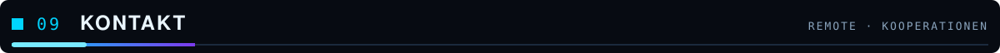

<div align="center">

**Lust, gemeinsam etwas Bedeutendes zu bauen?**<br>
Offen für Remote-Stellen, Software-Kooperationen und spannende Projekte — Griechenland / EU.

<a href="https://www.linkedin.com/in/maximiliano-olmos-sanchez"></a>
<a href="https://github.com/MAXIMILIANOGROSS"></a>
<a href="https://enodeus.ch"></a>
<a href="https://islandcrew.es"></a>
<a href="https://www.youtube.com/@IslandCrewYT"></a>
<a href="https://lebenslaufy.com"></a>

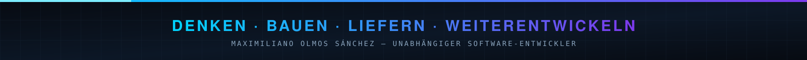

</div>


