<!-- GENERATED FILE: edit templates/README.tpl.md, scripts/i18n.py and data/*.json, then run `python3 scripts/build.py`. -->
<div align="center">

<p>🌐 <a href="README.md"></a> <a href="README.es.md"></a> <a href="README.de.md"></a> <a href="README.it.md"></a> <a href="README.fr.md"></a> <a href="README.zh.md"></a> <a href="README.ar.md"></a> </p>


<a href="#about"></a>
<a href="#products"></a>
<a href="#radar"></a>
<a href="#building"></a>
<a href="#metrics"></a>
<a href="#connect"></a>

**Convierto ideas en software.**<br>
Aplicaciones · software de escritorio · plataformas web · IA y automatización — del concepto al despliegue.

<sub><i>He inspeccionado soldaduras, motores de aviones y cohetes. Ahora inspecciono código.</i></sub>

<br><br>


</div>


<a id="about"></a>
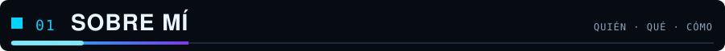

<table>
<tr>
<td width="260" valign="top" align="center">


</td>
<td valign="top">

Soy desarrollador de software independiente y creador de productos. No entrego funciones sueltas: entrego **productos completos**: idea, interfaz, aplicación, backend, integraciones, pruebas, documentación y lanzamiento.

Vengo de la calidad de nivel aeroespacial: END desde 2007, **PLD Space** (Miura 1), auditorías en **Bureau Veritas** y **SR Technics** — por eso construyo con mentalidad de *tolerancia cero*: trazabilidad, verificación y resultados reproducibles.

</td>
</tr>
</table>

<table>
<tr>
<td width="50%" valign="top">

**LO QUE CONSTRUYO**

- Apps móviles (iOS · Android)
- Software de escritorio (macOS · Windows)
- Plataformas web
- Herramientas de IA y agentes de voz
- Automatización y ecosistemas de software

</td>
<td width="50%" valign="top">

**CÓMO TRABAJO**

`Pensar → Diseñar → Construir → Probar → Desplegar → Mejorar`

Independiente, documentado, entregado. Aprendo creando productos reales.

</td>
</tr>
</table>

<details open>
<summary><b>🌐 El ecosistema Island Crew — talento, oficina IA, restaurantes, academia, medios</b></summary>

<br>

<div align="center">


<sub>Un ecosistema para personas, negocios e innovación en Canarias — Maxi OS coordina una Oficina IA de 60 agentes en 16 departamentos.</sub>

</div>

</details>


<a id="products"></a>
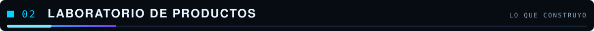

<div align="center">

<table>
<tr>
<td width="50%" valign="top">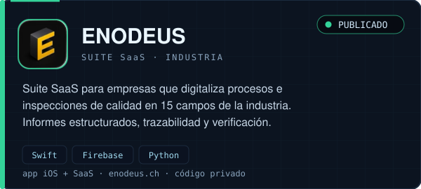<br><a href="https://enodeus.ch"><b>Abrir Enodeus →</b></a></td>
<td width="50%" valign="top">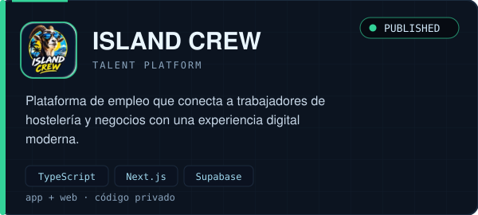<br><a href="https://islandcrew.es"><b>Abrir Island Crew →</b></a></td>
</tr>
<tr>
<td width="50%" valign="top">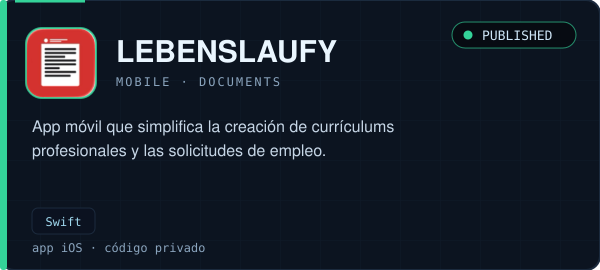<br><a href="https://lebenslaufy.com"><b>Abrir Lebenslaufy →</b></a></td>
<td width="50%" valign="top">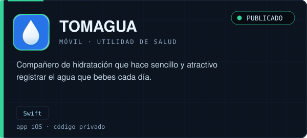<br><sub>código privado</sub></td>
</tr>
<tr>
<td width="50%" valign="top">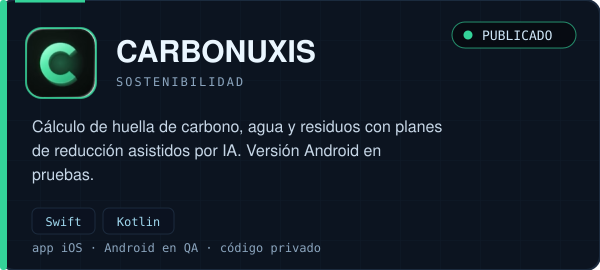<br><sub>código privado</sub></td>
<td width="50%" valign="top">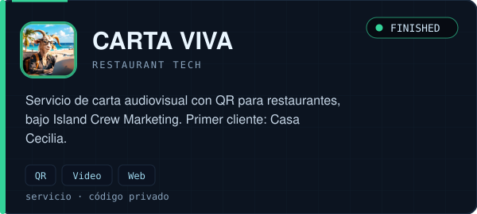<br><sub>código privado</sub></td>
</tr>
<tr>
<td width="50%" valign="top">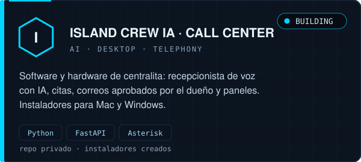<br><sub>código privado</sub></td>
</tr>
</table>

<details open>
<summary><b>📱 En la App Store — mis apps publicadas para iPhone y iPad</b></summary>

<br>


</details>

<sub>Las etiquetas de estado son honestas: salen de <code>data/projects.json</code>. «Código privado» significa que el producto existe, pero el código no es público.</sub>

</div>

<a id="radar"></a>
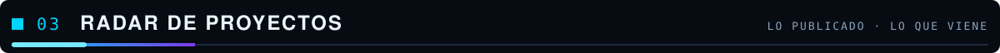

<div align="center">


</div>


<a id="building"></a>
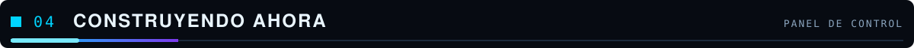

<div align="center">


</div>

**Island Crew IA — Call Center Software & Hardware.** Una centralita telefónica con recepcionista de voz con IA: atiende llamadas, agenda citas, redacta correos a clientes que el dueño aprueba e informa mediante paneles. Instaladores para macOS y Windows.

<details>
<summary><b>📸 Galería de la centralita — interfaz, concepto de hardware y marketing</b></summary>

<br>

<div align="center">


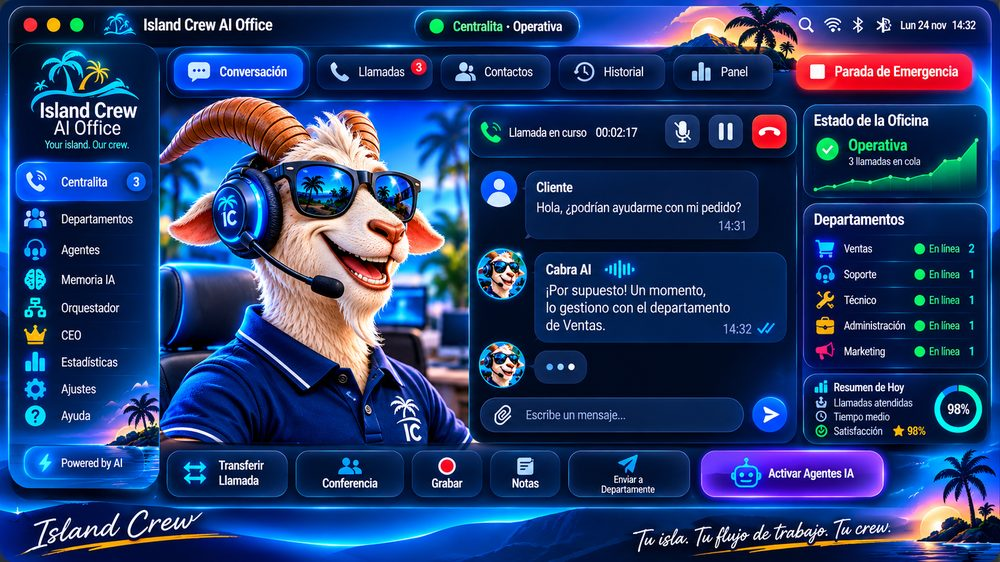

<table>
<tr>
<td width="50%"></td>
<td width="50%">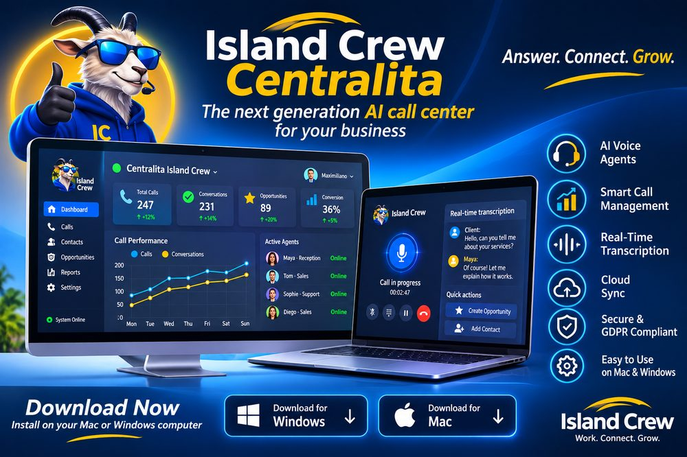</td>
</tr>
<tr>
<td colspan="2"></td>
</tr>
</table>

<sub>Las imágenes de hardware y marketing son conceptos de diseño; la interfaz es el software real.</sub>

</div>

</details>

<details>
<summary><b>⚡ Áreas de exploración y hoja de ruta</b></summary>

<br>

| Área | Dirección |
|---|---|
| Móvil | Evolucionar las apps publicadas; Carbonuxis Android en pruebas QA |
| Escritorio | Software multiplataforma descargable con instaladores de un clic |
| IA | Integraciones útiles y reales: agentes de voz, resúmenes, agenda |
| Automatización | Eliminar trabajo repetitivo, con una persona que aprueba lo importante |
| Infraestructura | Fiabilidad, arquitectura, automatización de lanzamientos |

</details>

<a id="pipeline"></a>


<div align="center">


</div>

<details>
<summary><b>▸ El flujo como diagrama (Mermaid)</b></summary>

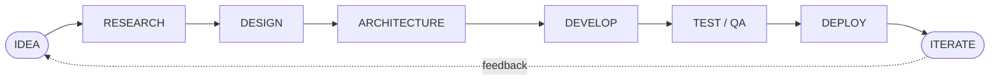

</details>

<details>
<summary><b>▸ Principios de ingeniería</b></summary>

<br>

- **Verificar, no suponer.** Cada afirmación se prueba antes de darla por hecha.
- **Trazabilidad.** Del mundo END: cada resultado se puede rastrear hasta su origen.
- **Una persona al mando.** La automatización propone; el dueño aprueba lo que sale.
- **Lanzar poco y real.** Una versión que funciona vale más que un plan perfecto.

</details>

<a id="stack"></a>


<div align="center">


</div>

<details>
<summary><b>▸ Stack en iconos</b></summary>

<br>

<div align="center">

<br>
<br>


</div>

</details>

<div align="center">

<sub>Solo tecnologías que aparecen en mis repositorios reales.</sub>

</div>

<a id="career"></a>


<details open>
<summary><b>🧬 De inspector END a creador de software — mi camino</b></summary>

<br>

<div align="center">


<br>

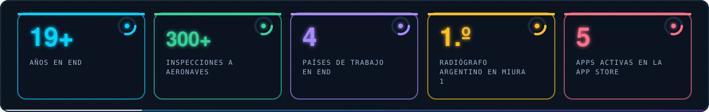

</div>

El END es mi oficio desde 2007: soldaduras, motores de aeronaves y estructuras de cohete, en Argentina, España y Suiza. En **PLD Space** trabajé en **Miura 1** — el primer cohete fabricado en España — y fui el primer radiógrafo argentino en realizar ensayos radiográficos en él. En **SR Technics** hice **más de 300 inspecciones a componentes críticos de aeronaves**. Hace aproximadamente un año empecé la transición al software: aprendí Swift y SwiftUI por mi cuenta y publiqué **ENODEUS**, una app iOS nativa que automatiza el trabajo de inspección que antes hacía a mano. Misma disciplina, nuevo material.

- VT, PT, MT, RT y UT en la práctica, en aeroespacial, energía e industria
- Trabajo bajo requisitos EASA, EN 4179, ISO 9001 y ASME: informes, no conformidades, análisis de causa raíz, auditorías
- Ahora: Swift, SwiftUI, Firebase y cumplimiento de la App Store — los hábitos de lanzar un producto real

<div align="center">

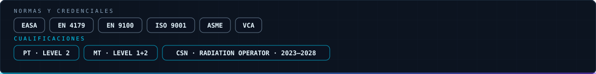

<br><br>


</div>

<sub>PT = líquidos penetrantes · MT = partículas magnéticas · VT = visual · RT = radiografía</sub>

<div align="center">

<table>
<tr>
<td width="33%"></td>
<td width="33%"></td>
<td width="33%"></td>
</tr>
</table>

<sub>SR Technics, Zúrich: inspección con penetrantes fluorescentes de un componente de motor, la nave de motores y la línea FPI.</sub>

<table>
<tr>
<td width="25%"></td>
<td width="25%"></td>
<td width="25%"></td>
<td width="25%"></td>
</tr>
</table>

<sub>Fotos de mi etapa en PLD Space: inspeccionando una sección de depósito, el taller y un lanzamiento de cohete.</sub>

</div>

</details>

<a id="metrics"></a>


<div align="center">

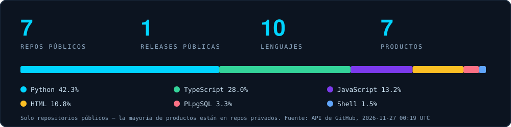

<picture><source media="(prefers-color-scheme: dark)" srcset="assets/generated/snake-dark.svg"></picture>

</div>

<details>
<summary><b>📦 Repositorios públicos (generado automáticamente)</b></summary>

<br>

| Repository | What it is | Language | Latest release | Updated |
|---|---|---|---|---|
| [`island-crew-downloads`](https://github.com/MAXIMILIANOGROSS/island-crew-downloads) | island-crew-downloads | HTML | [island-crew-suite-v1.0.0-macos-arm64](https://github.com/MAXIMILIANOGROSS/island-crew-downloads/releases/tag/island-crew-suite-v1.0.0-macos-arm64) | 2026-11-23 |
| [`islandcrewsuite`](https://github.com/MAXIMILIANOGROSS/islandcrewsuite) | suite marketing | Python | — | 2026-11-15 |
| [`meeting-booker-repo`](https://github.com/MAXIMILIANOGROSS/meeting-booker-repo) | — | JavaScript | — | 2026-11-01 |
| [`MyBrain`](https://github.com/MAXIMILIANOGROSS/MyBrain) | Your second self: observes real data, proposes one action a day, waits for your approval, and learns. Free, MIT | TypeScript | — | 2026-10-28 |
| [`virtual-office`](https://github.com/MAXIMILIANOGROSS/virtual-office) | Oficina virtual 3D con 43 agentes de IA. Plantilla en blanco, Next.js + Supabase. | TypeScript | — | 2026-10-23 |
| [`carbon-is-android`](https://github.com/MAXIMILIANOGROSS/carbon-is-android) | carbonáis para android | — | — | 2026-09-24 |
| [`island-crew-legal`](https://github.com/MAXIMILIANOGROSS/island-crew-legal) | — | — | — | 2026-09-21 |

<sub>Última actualización por GitHub Actions: 2026-11-26 19:16 UTC</sub>

</details>

<a id="lab"></a>


| Proyecto | Estado | Qué es | |
|---|---|---|---|
| **ENODEUS** | `SUITE SaaS` | Suite SaaS para empresas: digitaliza procesos e inspecciones de calidad para 15 campos de la industria. | [web](https://enodeus.ch) |
| **MyBrain** | `CÓDIGO ABIERTO · MIT` | Un segundo yo: observa datos reales, propone una acción al día, espera aprobación y aprende. | [repo](https://github.com/MAXIMILIANOGROSS/MyBrain) |
| **Virtual Office** | `CÓDIGO ABIERTO` | Oficina virtual 3D con 43 agentes de IA. Plantilla en blanco sobre Next.js + Supabase. | [repo](https://github.com/MAXIMILIANOGROSS/virtual-office) |
| **Island Crew Suite** | `VERSIÓN` | Suite de marketing autoinstalable para Mac / Windows para restaurantes. Descargas publicadas como releases. | [repo](https://github.com/MAXIMILIANOGROSS/island-crew-downloads) |

<details>
<summary><b>🎧 Más allá del software</b></summary>

<br>

<div align="center">

  

</div>

Producción musical, diseño sonoro, conceptos visuales y marca — incluido **Cabra Beats**, una herramienta de creación musical con IA para jingles y canciones de negocios. Pensamiento técnico unido a creatividad.

<a href="https://www.youtube.com/@IslandCrewYT"></a> <sub>Canal automatizado — canciones y jingles publicados por Cabra Beats.</sub>

</details>

<details>
<summary><code>sudo reveal_more</code></summary>

<br>

```text
[sudo] password for maximiliano: ********
Access granted.

> This profile is generated by its own scripts (scripts/build.py).
> Every number above is pulled from the GitHub API — or it isn't shown.
> Fun fact: the radar sweeps once every 12 seconds. Nobody asked, it just felt right.
> The next build is already running. Check back soon.
```

</details>

<a id="connect"></a>
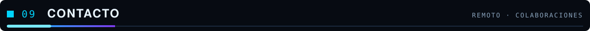

<div align="center">

**¿Quieres que construyamos algo importante juntos?**<br>
Abierto a oportunidades en remoto, colaboraciones de software y proyectos interesantes — Grecia / UE.

<a href="https://www.linkedin.com/in/maximiliano-olmos-sanchez"></a>
<a href="https://github.com/MAXIMILIANOGROSS"></a>
<a href="https://enodeus.ch"></a>
<a href="https://islandcrew.es"></a>
<a href="https://www.youtube.com/@IslandCrewYT"></a>
<a href="https://lebenslaufy.com"></a>

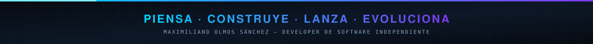

</div>


