<!-- GENERATED FILE: edit templates/README.tpl.md, scripts/i18n.py and data/*.json, then run `python3 scripts/build.py`. -->
<div align="center">

<p>🌐 <a href="README.md"></a> <a href="README.es.md"></a> <a href="README.de.md"></a> <a href="README.it.md"></a> <a href="README.fr.md"></a> <a href="README.zh.md"></a> <a href="README.ar.md"></a> </p>


<a href="#about"></a>
<a href="#products"></a>
<a href="#radar"></a>
<a href="#building"></a>
<a href="#metrics"></a>
<a href="#connect"></a>

**Je transforme les idées en logiciels.**<br>
Applications · logiciels de bureau · plateformes web · IA & automatisation — du concept au déploiement.

<sub><i>J'ai inspecté des soudures, des moteurs d'avions et des fusées. Maintenant, j'inspecte du code.</i></sub>

<br><br>


</div>


<a id="about"></a>
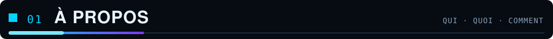

<table>
<tr>
<td width="260" valign="top" align="center">


</td>
<td valign="top">

Je suis développeur logiciel indépendant et créateur de produits. Je ne livre pas des fonctions isolées : je livre des **produits complets** : idée, interface, application, backend, intégrations, tests, documentation et mise en production.

Mon parcours est celui de la qualité de niveau aérospatial : CND depuis 2007, **PLD Space** (Miura 1), audits chez **Bureau Veritas** et **SR Technics** — d'où ma mentalité de *tolérance zéro* : traçabilité, vérification, résultats reproductibles.

</td>
</tr>
</table>

<table>
<tr>
<td width="50%" valign="top">

**CE QUE JE CONSTRUIS**

- Applications mobiles (iOS · Android)
- Logiciels de bureau (macOS · Windows)
- Plateformes web
- Outils d'IA et agents vocaux
- Automatisation et écosystèmes logiciels

</td>
<td width="50%" valign="top">

**MA FAÇON DE TRAVAILLER**

`Réfléchir → Concevoir → Construire → Tester → Déployer → Améliorer`

Indépendant, documenté, livré. J'apprends en créant de vrais produits.

</td>
</tr>
</table>

<details open>
<summary><b>🧬 D'inspecteur CND à créateur de logiciels — mon parcours</b></summary>

<br>

<div align="center">


<br>

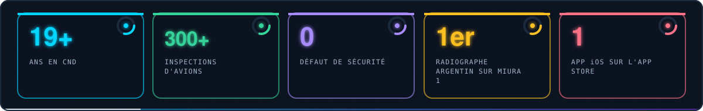

</div>

Le CND est mon métier depuis 2007 : soudures, moteurs d'avions et structures de fusée, en Argentine, en Espagne et en Suisse. Chez **PLD Space**, j'ai travaillé sur **Miura 1** — la première fusée construite en Espagne — et je suis le premier radiographe argentin à y avoir réalisé des contrôles radiographiques. Chez **SR Technics**, j'ai réalisé **plus de 300 inspections de composants critiques d'avions sans aucun défaut de sécurité**. Il y a environ un an, j'ai entamé la transition vers le logiciel : j'ai appris Swift et SwiftUI en autodidacte et publié **ENODEUS**, une app iOS native qui automatise le travail d'inspection que je faisais à la main. Même discipline, nouveau matériau.

- VT, PT, MT, RT et UT sur le terrain, en aérospatial, énergie et industrie
- Travail selon les exigences EASA, EN 4179, ISO 9001 et ASME : rapports, non-conformités, analyse des causes racines, audits
- Aujourd'hui : Swift, SwiftUI, Firebase et conformité App Store — les réflexes de livrer un vrai produit

<div align="center">

<b>Normes et habilitations</b><br>
       <br>
  

<br><br>


</div>

<sub>PT = ressuage · MT = magnétoscopie · VT = visuel · RT = radiographie</sub>

<div align="center">

<table>
<tr>
<td width="33%"></td>
<td width="33%"></td>
<td width="33%">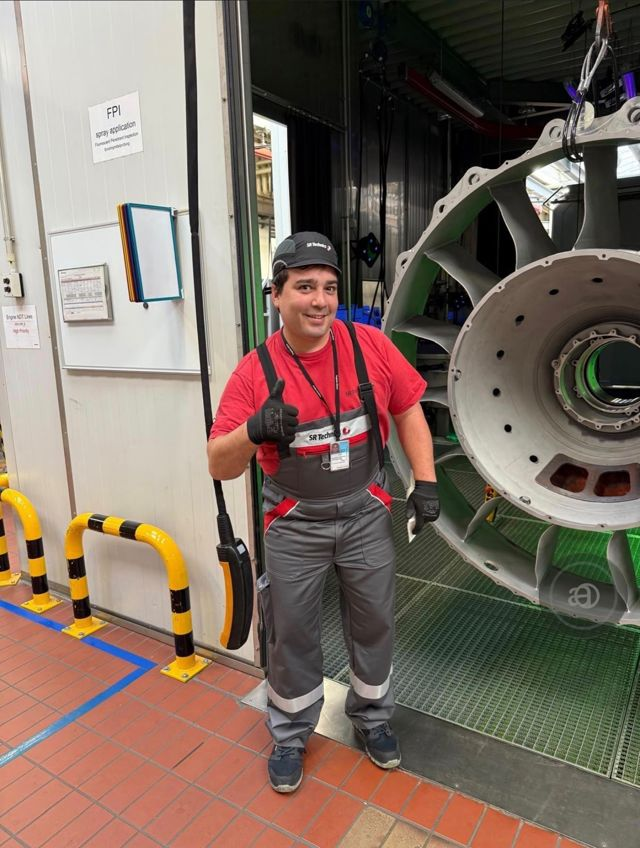</td>
</tr>
</table>

<sub>SR Technics, Zurich : ressuage fluorescent d'un composant de moteur, le hall moteurs et la ligne FPI.</sub>

<table>
<tr>
<td width="25%"></td>
<td width="25%"></td>
<td width="25%"></td>
<td width="25%"></td>
</tr>
</table>

<sub>Photos de mon passage chez PLD Space : inspection d'une section de réservoir, l'atelier et un lancement de fusée.</sub>

</div>

</details>

<details open>
<summary><b>🌐 L'écosystème Island Crew — talents, bureau IA, restaurants, académie, médias</b></summary>

<br>

<div align="center">


<sub>Un écosystème pour les personnes, les entreprises et l'innovation aux Canaries — Maxi OS coordonne un Bureau IA de 60 agents répartis en 16 départements.</sub>

<br><br>

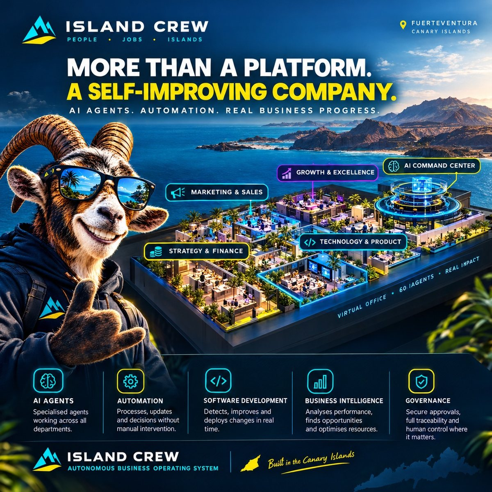

<sub>Le Bureau Virtuel d'Island Crew — 60 agents IA par département, un centre de commande IA et une validation humaine là où ça compte.</sub>

</div>

</details>


<a id="products"></a>
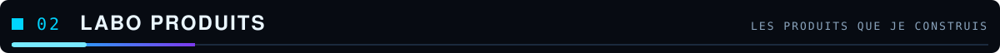

<div align="center">

<table>
<tr>
<td width="50%" valign="top">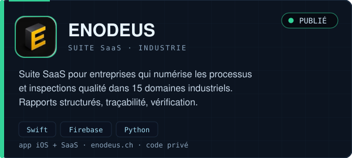<br><a href="https://enodeus.ch"><b>Ouvrir Enodeus →</b></a></td>
<td width="50%" valign="top">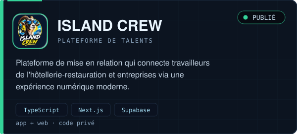<br><a href="https://islandcrew.es"><b>Ouvrir Island Crew →</b></a></td>
</tr>
<tr>
<td width="50%" valign="top">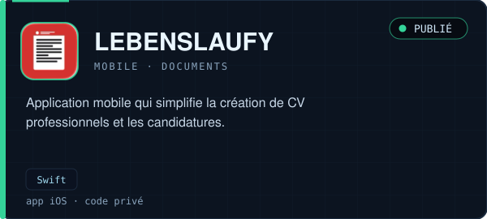<br><a href="https://lebenslaufy.com"><b>Ouvrir Lebenslaufy →</b></a></td>
<td width="50%" valign="top">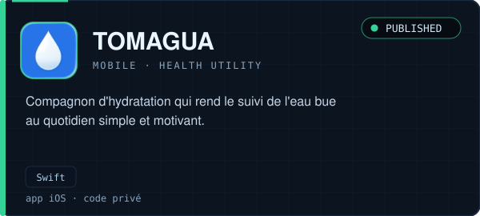<br><sub>code privé</sub></td>
</tr>
<tr>
<td width="50%" valign="top">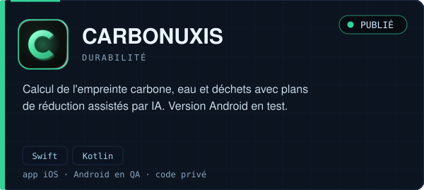<br><sub>code privé</sub></td>
<td width="50%" valign="top">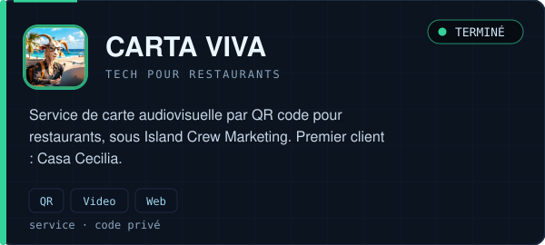<br><sub>code privé</sub></td>
</tr>
<tr>
<td width="50%" valign="top">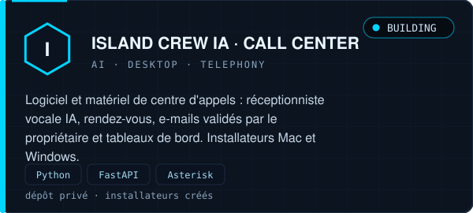<br><sub>code privé</sub></td>
</tr>
</table>

<details open>
<summary><b>📱 Sur l'App Store — mes apps publiées pour iPhone et iPad</b></summary>

<br>


</details>

<sub>Les étiquettes de statut sont honnêtes : elles viennent de <code>data/projects.json</code>. « Code privé » signifie que le produit existe, mais que le code n'est pas public.</sub>

</div>

<a id="radar"></a>
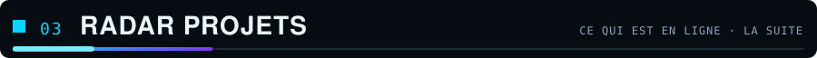

<div align="center">


</div>


<a id="building"></a>
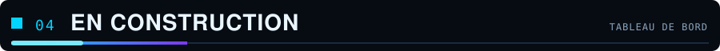

<div align="center">


</div>

**Island Crew IA — Call Center Software & Hardware.** Un standard téléphonique avec réceptionniste vocale IA : il répond aux appels, prend des rendez-vous, rédige des e-mails clients que le propriétaire valide et rend compte via des tableaux de bord. Installateurs pour macOS et Windows.

<details>
<summary><b>📸 Galerie du standard — interface, concept matériel et marketing</b></summary>

<br>

<div align="center">


<table>
<tr>
<td width="50%"></td>
<td width="50%"></td>
</tr>
<tr>
<td colspan="2"></td>
</tr>
</table>

<sub>Les visuels matériel et marketing sont des concepts de design ; l'interface est le logiciel réel.</sub>

</div>

</details>

<details>
<summary><b>⚡ Pistes d'exploration et feuille de route</b></summary>

<br>

| Domaine | Direction |
|---|---|
| Mobile | Faire évoluer les apps publiées ; Carbonuxis Android en test QA |
| Bureau | Logiciels multiplateformes téléchargeables avec installation en un clic |
| IA | Intégrations utiles et réelles : agents vocaux, résumés, agenda |
| Automatisation | Supprimer le travail répétitif, avec une personne qui valide l'essentiel |
| Infrastructure | Fiabilité, architecture, automatisation des versions |

</details>

<a id="pipeline"></a>
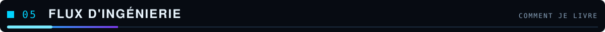

<div align="center">


</div>

<details>
<summary><b>▸ Le flux sous forme de diagramme (Mermaid)</b></summary>

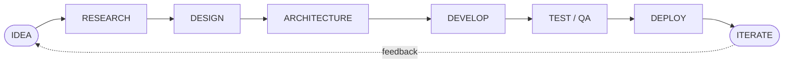

</details>

<details>
<summary><b>▸ Principes d'ingénierie</b></summary>

<br>

- **Vérifier, ne pas supposer.** Chaque affirmation est testée avant d'être déclarée terminée.
- **Traçabilité.** Issue du monde du CND : chaque résultat remonte à sa source.
- **L'humain dans la boucle.** L'automatisation propose ; le propriétaire valide ce qui sort.
- **Livrer petit, livrer vrai.** Une version qui fonctionne vaut mieux qu'un plan parfait.

</details>

<a id="stack"></a>
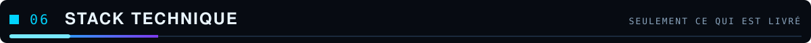

<div align="center">


</div>

<details>
<summary><b>▸ Stack en icônes</b></summary>

<br>

<div align="center">

<br>
<br>


</div>

</details>

<div align="center">

<sub>Uniquement des technologies présentes dans mes dépôts réels.</sub>

</div>

<a id="metrics"></a>
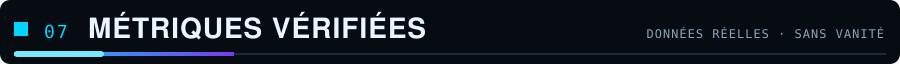

<div align="center">

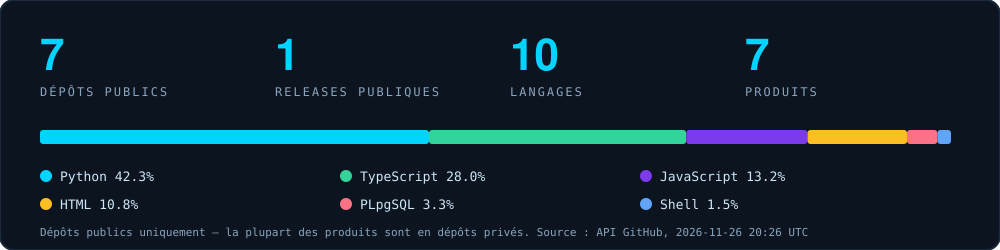

<picture><source media="(prefers-color-scheme: dark)" srcset="assets/generated/snake-dark.svg"></picture>

</div>

<details>
<summary><b>📦 Dépôts publics (généré automatiquement)</b></summary>

<br>

| Repository | What it is | Language | Latest release | Updated |
|---|---|---|---|---|
| [`island-crew-downloads`](https://github.com/MAXIMILIANOGROSS/island-crew-downloads) | island-crew-downloads | HTML | [island-crew-suite-v1.0.0-macos-arm64](https://github.com/MAXIMILIANOGROSS/island-crew-downloads/releases/tag/island-crew-suite-v1.0.0-macos-arm64) | 2026-11-23 |
| [`islandcrewsuite`](https://github.com/MAXIMILIANOGROSS/islandcrewsuite) | suite marketing | Python | — | 2026-11-15 |
| [`meeting-booker-repo`](https://github.com/MAXIMILIANOGROSS/meeting-booker-repo) | — | JavaScript | — | 2026-11-01 |
| [`MyBrain`](https://github.com/MAXIMILIANOGROSS/MyBrain) | Your second self: observes real data, proposes one action a day, waits for your approval, and learns. Free, MIT | TypeScript | — | 2026-10-28 |
| [`virtual-office`](https://github.com/MAXIMILIANOGROSS/virtual-office) | Oficina virtual 3D con 43 agentes de IA. Plantilla en blanco, Next.js + Supabase. | TypeScript | — | 2026-10-23 |
| [`carbon-is-android`](https://github.com/MAXIMILIANOGROSS/carbon-is-android) | carbonáis para android | — | — | 2026-09-24 |
| [`island-crew-legal`](https://github.com/MAXIMILIANOGROSS/island-crew-legal) | — | — | — | 2026-09-21 |

<sub>Dernière mise à jour par GitHub Actions : 2026-11-26 13:46 UTC</sub>

</details>

<a id="lab"></a>
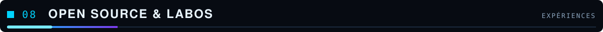

| Projet | Statut | De quoi s'agit-il | |
|---|---|---|---|
| **ENODEUS** | `SaaS SUITE` | Suite SaaS pour entreprises : numérise processus et inspections qualité pour 15 domaines industriels. | [site](https://enodeus.ch) |
| **MyBrain** | `OPEN SOURCE · MIT` | Un second soi : observe des données réelles, propose une action par jour, attend la validation et apprend. | [dépôt](https://github.com/MAXIMILIANOGROSS/MyBrain) |
| **Virtual Office** | `OPEN SOURCE` | Bureau virtuel 3D avec 43 agents IA. Modèle vierge sur Next.js + Supabase. | [dépôt](https://github.com/MAXIMILIANOGROSS/virtual-office) |
| **Island Crew Suite** | `RELEASE` | Suite marketing auto-installable Mac / Windows pour restaurants. Téléchargements publiés en releases. | [dépôt](https://github.com/MAXIMILIANOGROSS/island-crew-downloads) |

<details>
<summary><b>🎧 Au-delà du logiciel</b></summary>

<br>

<div align="center">

  

</div>

Production musicale, design sonore, concepts visuels et branding — dont **Cabra Beats**, un outil de création musicale assisté par IA pour jingles et chansons d'entreprise. La pensée technique alliée à la créativité.

<a href="https://www.youtube.com/@IslandCrewYT"></a> <sub>Chaîne automatisée — chansons et jingles publiés par Cabra Beats.</sub>

</details>

<details>
<summary><code>sudo reveal_more</code></summary>

<br>

```text
[sudo] password for maximiliano: ********
Access granted.

> This profile is generated by its own scripts (scripts/build.py).
> Every number above is pulled from the GitHub API — or it isn't shown.
> Fun fact: the radar sweeps once every 12 seconds. Nobody asked, it just felt right.
> The next build is already running. Check back soon.
```

</details>

<a id="connect"></a>
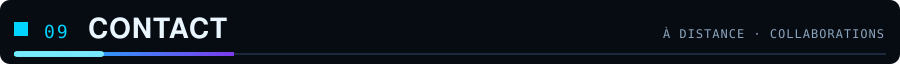

<div align="center">

**Envie de construire quelque chose d'important ensemble ?**<br>
Ouvert aux opportunités à distance, aux collaborations logicielles et aux projets intéressants — Grèce / UE.

<a href="https://www.linkedin.com/in/maximiliano-olmos-sanchez"></a>
<a href="https://github.com/MAXIMILIANOGROSS"></a>
<a href="https://enodeus.ch"></a>
<a href="https://islandcrew.es"></a>
<a href="https://www.youtube.com/@IslandCrewYT"></a>
<a href="https://lebenslaufy.com"></a>

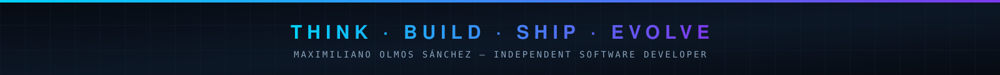

</div>


