<!-- GENERATED FILE: edit templates/README.tpl.md, scripts/i18n.py and data/*.json, then run `python3 scripts/build.py`. -->
<div align="center">

<p>🌐 <a href="README.md"></a> <a href="README.es.md"></a> <a href="README.de.md"></a> <a href="README.it.md"></a> <a href="README.fr.md"></a> <a href="README.zh.md"></a> <a href="README.ar.md"></a> </p>


<a href="#about"></a>
<a href="#products"></a>
<a href="#radar"></a>
<a href="#building"></a>
<a href="#metrics"></a>
<a href="#connect"></a>

**Trasformo le idee in software.**<br>
App · software desktop · piattaforme web · IA e automazione — dal concept al rilascio.

<br><br>


</div>


<a id="about"></a>
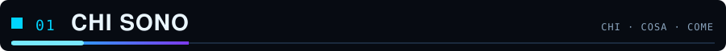

<table>
<tr>
<td width="260" valign="top" align="center">


</td>
<td valign="top">

Sono uno sviluppatore software indipendente e costruttore di prodotti. Non consegno funzioni isolate: consegno **prodotti completi**: idea, interfaccia, applicazione, backend, integrazioni, test, documentazione e rilascio.

Vengo dalla qualità di livello aerospaziale — assistenza tecnica in **SR Technics**, qualità in **Bureau Veritas**, controlli non distruttivi su componenti di razzi in **PLD Space** e audit interni ISO 9001 — per questo lavoro con una mentalità di *tolleranza zero*: tracciabilità, verifica, risultati riproducibili.

</td>
</tr>
</table>

<table>
<tr>
<td width="50%" valign="top">

**COSA COSTRUISCO**

- App mobile (iOS · Android)
- Software desktop (macOS · Windows)
- Piattaforme web
- Strumenti di IA e agenti vocali
- Automazione ed ecosistemi software

</td>
<td width="50%" valign="top">

**COME LAVORO**

`Pensare → Progettare → Costruire → Testare → Rilasciare → Migliorare`

Indipendente, documentato, consegnato. Imparo creando prodotti reali.

</td>
</tr>
</table>

<details open>
<summary><b>✈️ Prima del software — CND aerospaziali: SR Technics e PLD Space</b></summary>

<br>

<div align="center">

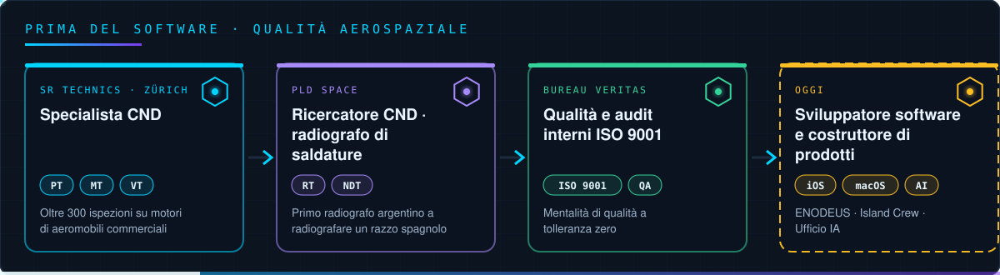

</div>

Sono partito dalla qualità aerospaziale. In **SR Technics** (Zurigo) sono stato **specialista CND — PT, MT e VT — con più di 300 ispezioni su motori di aeromobili commerciali**. In **PLD Space** sono stato **ricercatore CND e radiografo industriale di saldature (RT)**, e il primo radiografo argentino ad aver radiografato un razzo spagnolo. Quella disciplina — ispezionare, documentare, tracciare, mai supporre — è come costruisco software oggi.

- Controllo con liquidi penetranti fluorescenti, particelle magnetiche e visivo su componenti di motore
- Radiografia industriale delle saldature su strutture di razzi
- Report tracciabili e basati su norme — la radice di ENODEUS

<sub>PT = liquidi penetranti · MT = particelle magnetiche · VT = visivo · RT = radiografia</sub>

<div align="center">

<table>
<tr>
<td width="33%"></td>
<td width="33%"></td>
<td width="33%"></td>
</tr>
</table>

<sub>SR Technics, Zurigo: controllo con penetranti fluorescenti di un componente di motore, il reparto motori e la linea FPI.</sub>

<table>
<tr>
<td width="25%">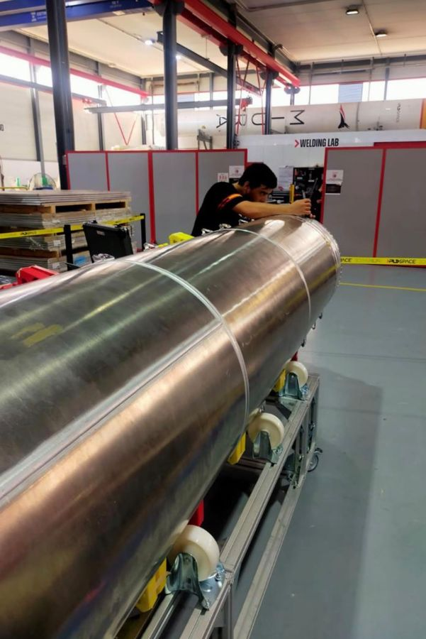</td>
<td width="25%"></td>
<td width="25%"></td>
<td width="25%"></td>
</tr>
</table>

<sub>Foto del mio periodo in PLD Space: ispezione di una sezione di serbatoio, l'officina e un lancio di razzo.</sub>

</div>

</details>

<details open>
<summary><b>🌐 L'ecosistema Island Crew — talenti, ufficio IA, ristoranti, accademia, media</b></summary>

<br>

<div align="center">

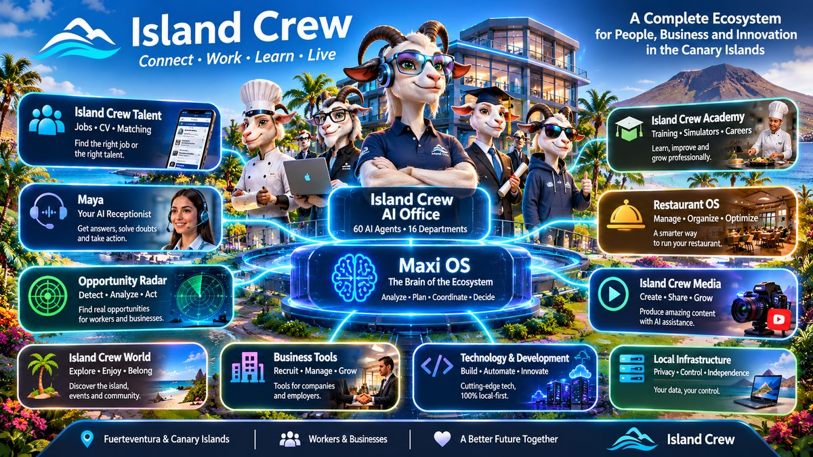

<sub>Un ecosistema per persone, imprese e innovazione alle Canarie — Maxi OS coordina un Ufficio IA di 60 agenti in 16 reparti.</sub>

</div>

</details>


<a id="products"></a>
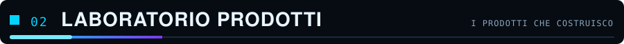

<div align="center">

<table>
<tr>
<td width="50%" valign="top">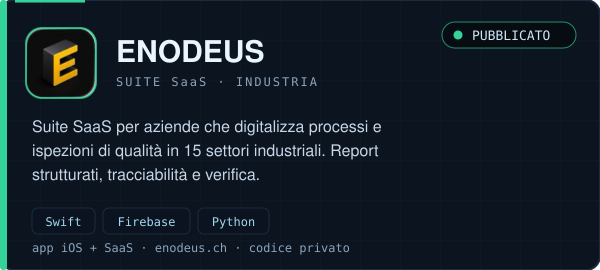<br><a href="https://enodeus.ch"><b>Apri Enodeus →</b></a></td>
<td width="50%" valign="top">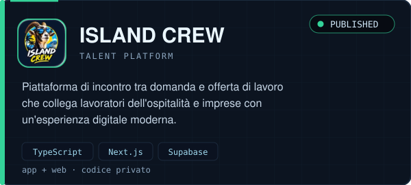<br><a href="https://islandcrew.es"><b>Apri Island Crew →</b></a></td>
</tr>
<tr>
<td width="50%" valign="top">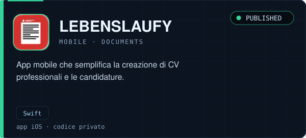<br><a href="https://lebenslaufy.com"><b>Apri Lebenslaufy →</b></a></td>
<td width="50%" valign="top">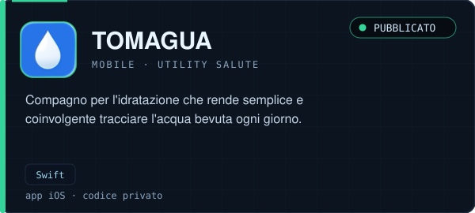<br><sub>codice privato</sub></td>
</tr>
<tr>
<td width="50%" valign="top">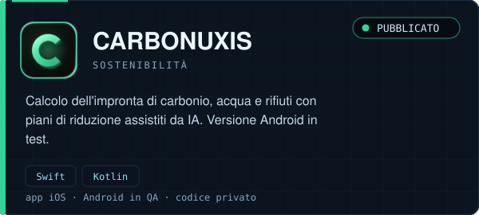<br><sub>codice privato</sub></td>
<td width="50%" valign="top">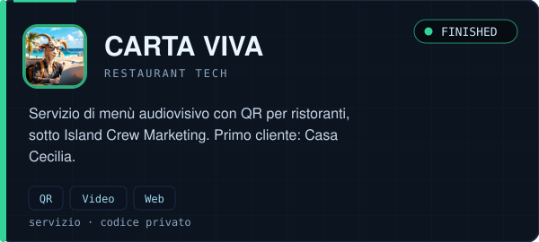<br><sub>codice privato</sub></td>
</tr>
<tr>
<td width="50%" valign="top">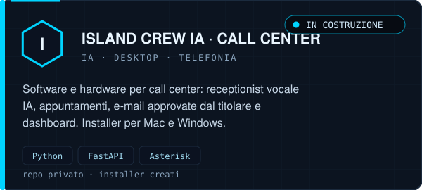<br><sub>codice privato</sub></td>
</tr>
</table>

<details open>
<summary><b>📱 Sull'App Store — le mie app pubblicate per iPhone e iPad</b></summary>

<br>


</details>

<sub>Le etichette di stato sono oneste: provengono da <code>data/projects.json</code>. «Codice privato» significa che il prodotto esiste, ma il codice non è pubblico.</sub>

</div>

<a id="radar"></a>
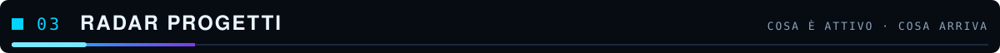

<div align="center">


</div>


<a id="building"></a>


<div align="center">


</div>

**Island Crew IA — Call Center Software & Hardware.** Un centralino telefonico con receptionist vocale basata su IA: risponde alle chiamate, fissa appuntamenti, prepara e-mail ai clienti che il titolare approva e riferisce tramite dashboard. Installer per macOS e Windows.

<details>
<summary><b>📸 Galleria del centralino — interfaccia, concept hardware e marketing</b></summary>

<br>

<div align="center">


<table>
<tr>
<td width="50%"></td>
<td width="50%"></td>
</tr>
<tr>
<td colspan="2">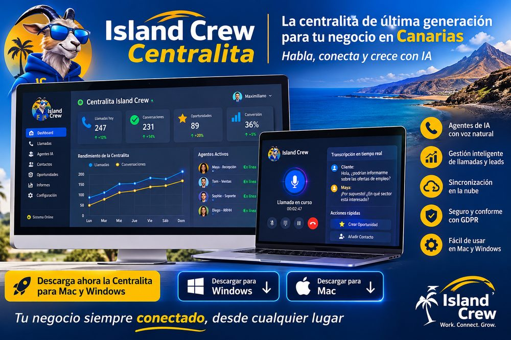</td>
</tr>
</table>

<sub>Le immagini di hardware e marketing sono concept di design; l'interfaccia è il software funzionante.</sub>

</div>

</details>

<details>
<summary><b>⚡ Aree di esplorazione e roadmap</b></summary>

<br>

| Area | Direzione |
|---|---|
| Mobile | Far evolvere le app pubblicate; Carbonuxis Android in test QA |
| Desktop | Software multipiattaforma scaricabile con installer a un clic |
| IA | Integrazioni utili e reali: agenti vocali, riassunti, agenda |
| Automazione | Eliminare il lavoro ripetitivo, con una persona che approva ciò che conta |
| Infrastruttura | Affidabilità, architettura, automazione dei rilasci |

</details>

<a id="pipeline"></a>
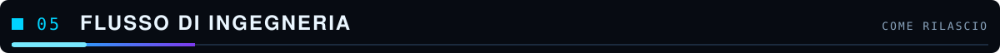

<div align="center">


</div>

<details>
<summary><b>▸ Il flusso come diagramma (Mermaid)</b></summary>

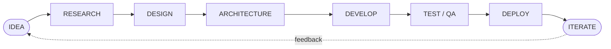

</details>

<details>
<summary><b>▸ Principi di ingegneria</b></summary>

<br>

- **Verificare, non supporre.** Ogni affermazione viene testata prima di darla per fatta.
- **Tracciabilità.** Dal mondo dei CND: ogni risultato è riconducibile alla sua origine.
- **Una persona al comando.** L'automazione propone; il titolare approva ciò che esce.
- **Rilasciare poco e vero.** Una versione funzionante batte un piano perfetto.

</details>

<a id="stack"></a>
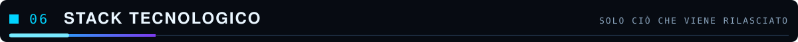

<div align="center">


</div>

<details>
<summary><b>▸ Stack in icone</b></summary>

<br>

<div align="center">

<br>
<br>


</div>

</details>

<div align="center">

<sub>Solo tecnologie presenti nei miei repository reali.</sub>

</div>

<a id="metrics"></a>
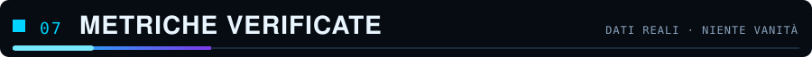

<div align="center">

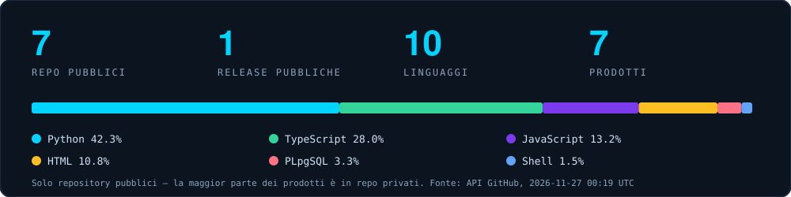

<picture><source media="(prefers-color-scheme: dark)" srcset="assets/generated/snake-dark.svg"></picture>

</div>

<details>
<summary><b>📦 Repository pubblici (generato automaticamente)</b></summary>

<br>

| Repository | What it is | Language | Latest release | Updated |
|---|---|---|---|---|
| [`island-crew-downloads`](https://github.com/MAXIMILIANOGROSS/island-crew-downloads) | island-crew-downloads | HTML | [island-crew-suite-v1.0.0-macos-arm64](https://github.com/MAXIMILIANOGROSS/island-crew-downloads/releases/tag/island-crew-suite-v1.0.0-macos-arm64) | 2026-11-23 |
| [`islandcrewsuite`](https://github.com/MAXIMILIANOGROSS/islandcrewsuite) | suite marketing | Python | — | 2026-11-15 |
| [`meeting-booker-repo`](https://github.com/MAXIMILIANOGROSS/meeting-booker-repo) | — | JavaScript | — | 2026-11-01 |
| [`MyBrain`](https://github.com/MAXIMILIANOGROSS/MyBrain) | Your second self: observes real data, proposes one action a day, waits for your approval, and learns. Free, MIT | TypeScript | — | 2026-10-28 |
| [`virtual-office`](https://github.com/MAXIMILIANOGROSS/virtual-office) | Oficina virtual 3D con 43 agentes de IA. Plantilla en blanco, Next.js + Supabase. | TypeScript | — | 2026-10-23 |
| [`carbon-is-android`](https://github.com/MAXIMILIANOGROSS/carbon-is-android) | carbonáis para android | — | — | 2026-09-24 |
| [`island-crew-legal`](https://github.com/MAXIMILIANOGROSS/island-crew-legal) | — | — | — | 2026-09-21 |

<sub>Ultimo aggiornamento da GitHub Actions: 2026-11-26 13:29 UTC</sub>

</details>

<a id="lab"></a>
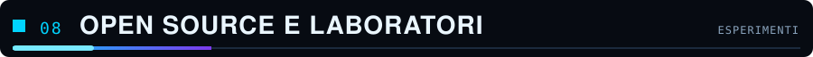

| Progetto | Stato | Cos'è | |
|---|---|---|---|
| **ENODEUS** | `SaaS SUITE` | Suite SaaS per aziende: digitalizza processi e ispezioni di qualità per 15 settori industriali. | [sito](https://enodeus.ch) |
| **MyBrain** | `OPEN SOURCE · MIT` | Un secondo io: osserva dati reali, propone un'azione al giorno, attende l'approvazione, impara. | [repo](https://github.com/MAXIMILIANOGROSS/MyBrain) |
| **Virtual Office** | `OPEN SOURCE` | Ufficio virtuale 3D con 43 agenti IA. Modello vuoto su Next.js + Supabase. | [repo](https://github.com/MAXIMILIANOGROSS/virtual-office) |
| **Island Crew Suite** | `RELEASE` | Suite di marketing autoinstallante per Mac / Windows per ristoranti. Download pubblicati come release. | [repo](https://github.com/MAXIMILIANOGROSS/island-crew-downloads) |

<details>
<summary><b>🎧 Oltre il software</b></summary>

<br>

<div align="center">

  

</div>

Produzione musicale, sound design, concept visivi e branding — incluso **Cabra Beats**, uno strumento di creazione musicale assistito da IA per jingle e canzoni aziendali. Pensiero tecnico unito alla creatività.

<a href="https://www.youtube.com/@IslandCrewYT"></a> <sub>Canale automatizzato — canzoni e jingle pubblicati da Cabra Beats.</sub>

</details>

<details>
<summary><code>sudo reveal_more</code></summary>

<br>

```text
[sudo] password for maximiliano: ********
Access granted.

> This profile is generated by its own scripts (scripts/build.py).
> Every number above is pulled from the GitHub API — or it isn't shown.
> Fun fact: the radar sweeps once every 12 seconds. Nobody asked, it just felt right.
> The next build is already running. Check back soon.
```

</details>

<a id="connect"></a>
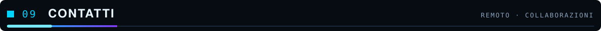

<div align="center">

**Ti va di costruire qualcosa di importante insieme?**<br>
Aperto a opportunità da remoto, collaborazioni software e progetti interessanti — Grecia / UE.

<a href="https://www.linkedin.com/in/maximiliano-olmos-sanchez"></a>
<a href="https://github.com/MAXIMILIANOGROSS"></a>
<a href="https://enodeus.ch"></a>
<a href="https://islandcrew.es"></a>
<a href="https://www.youtube.com/@IslandCrewYT"></a>
<a href="https://lebenslaufy.com"></a>

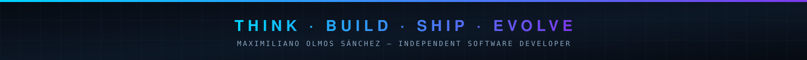

</div>


