<!-- GENERATED FILE: edit templates/README.tpl.md, scripts/i18n.py and data/*.json, then run `python3 scripts/build.py`. -->
<div align="center">

<p>🌐 <a href="README.md"></a> <a href="README.es.md"></a> <a href="README.de.md"></a> <a href="README.it.md"></a> <a href="README.fr.md"></a> <a href="README.zh.md"></a> <a href="README.ar.md"></a> </p>


<a href="#about"></a>&nbsp;<a href="#products"></a>&nbsp;<a href="#radar"></a>&nbsp;<a href="#building"></a>&nbsp;<a href="#career"></a>&nbsp;<a href="#metrics"></a>&nbsp;<a href="#connect"></a>

**I turn ideas into software.**<br>
Applications · desktop software · web platforms · AI & automation — from concept to deployment.

<sub><i>I've inspected welds, aircraft engines and rockets. Now I inspect code.</i></sub>

<br><br>


</div>


<a id="about"></a>
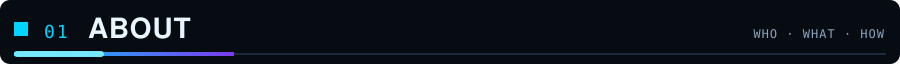

<div align="center">


</div>

I'm an independent software developer and product builder. I don't ship isolated features — I ship **complete products**: idea, interface, application, backend, integrations, testing, documentation and release.

My background is aerospace-grade quality: NDT since 2007, **PLD Space** (Miura 1), **Bureau Veritas** audits and **SR Technics** — so I build with a *zero-tolerance* mindset: traceability, verification, reproducible results.

<table>
<tr>
<td width="50%" valign="top">

**WHAT I BUILD**

- Mobile apps (iOS · Android)
- Desktop software (macOS · Windows)
- Web platforms
- AI tools & voice agents
- Automation & software ecosystems

</td>
<td width="50%" valign="top">

**HOW I WORK**

`Think → Design → Build → Test → Deploy → Improve`

Independent, documented, shipped. I learn by creating real products.

</td>
</tr>
</table>

<details open>
<summary><b>🌐 The Island Crew ecosystem — talent, AI office, restaurants, academy, media</b></summary>

<br>

<div align="center">


<sub>One ecosystem for people, business and innovation in the Canary Islands — Maxi OS coordinates an AI Office of 60 agents in 16 departments.</sub>

</div>

</details>


<a id="products"></a>
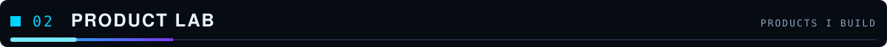

<div align="center">

<table>
<tr>
<td width="50%" valign="top">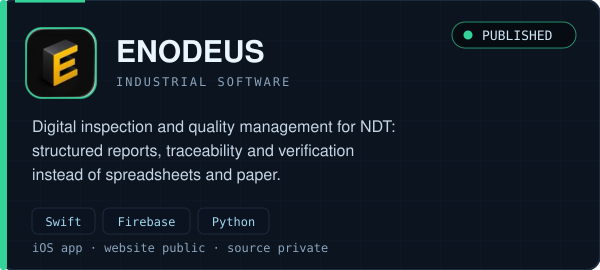<br><a href="https://enodeus.ch"><b>Open Enodeus →</b></a></td>
<td width="50%" valign="top">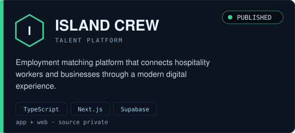<br><a href="https://islandcrew.es"><b>Open Island Crew →</b></a></td>
</tr>
<tr>
<td width="50%" valign="top">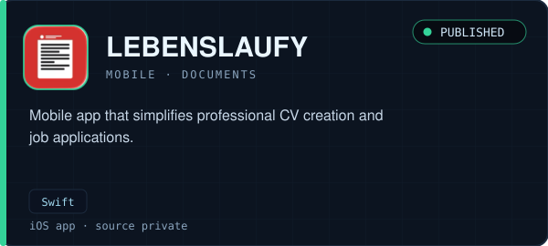<br><a href="https://lebenslaufy.com"><b>Open Lebenslaufy →</b></a></td>
<td width="50%" valign="top">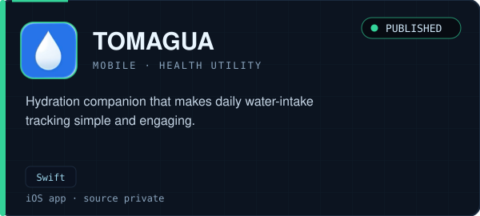<br><sub>private source</sub></td>
</tr>
<tr>
<td width="50%" valign="top">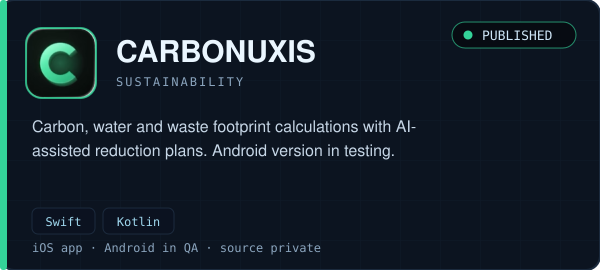<br><sub>private source</sub></td>
<td width="50%" valign="top">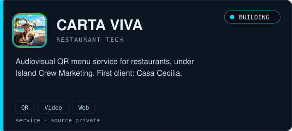<br><sub>private source</sub></td>
</tr>
<tr>
<td width="50%" valign="top">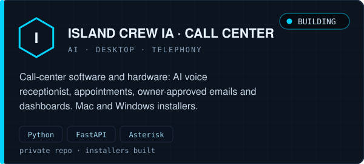<br><sub>private source</sub></td>
</tr>
</table>

<p align="center"><sub><b>PRODUCT WORLDS · REAL SCREENSHOTS OF LIVE SITES</b></sub></p>
<table><tr><td width="50%"><a href="https://enodeus.ch">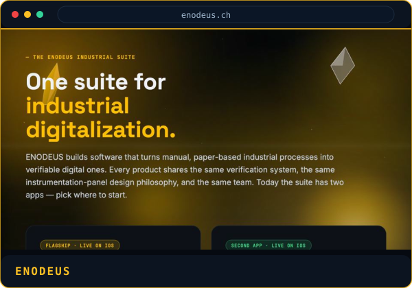</a></td><td width="50%"><a href="https://islandcrew.es">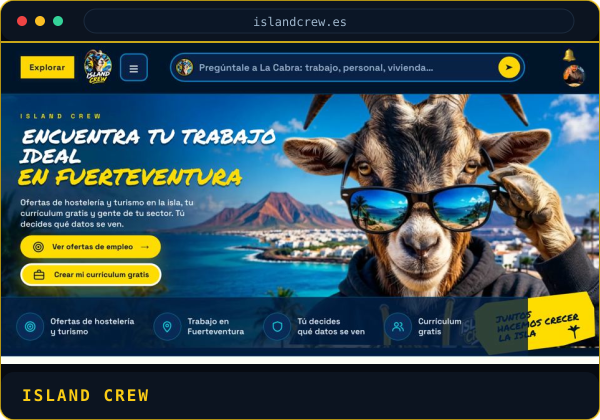</a></td></tr><tr><td><a href="https://enodeus.ch">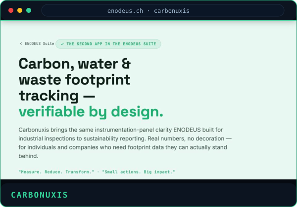</a></td><td><a href="https://lebenslaufy.com">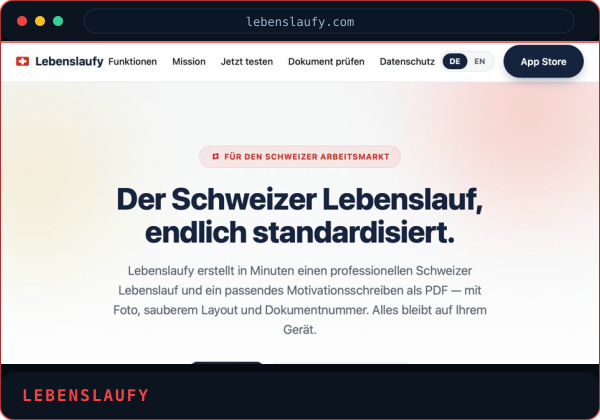</a></td></tr></table>

<details open>
<summary><b>📱 On the App Store — my published iPhone & iPad apps</b></summary>

<br>

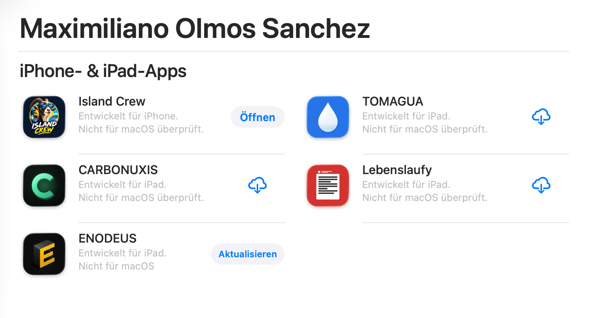

</details>

<sub>Status labels are honest: they come from <code>data/projects.json</code>. Private source means the product exists, the code is not public.</sub>

</div>

<a id="radar"></a>


<div align="center">


</div>


<a id="building"></a>
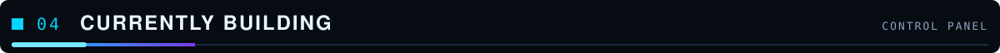

<div align="center">


</div>

**Island Crew IA — Call Center Software & Hardware.** A phone switchboard with an AI voice receptionist: it answers calls, books appointments, drafts client emails that the owner approves, and reports through dashboards. Installers for macOS and Windows.

<details>
<summary><b>📸 Call-center gallery — interface, hardware concept & marketing</b></summary>

<br>

<div align="center">

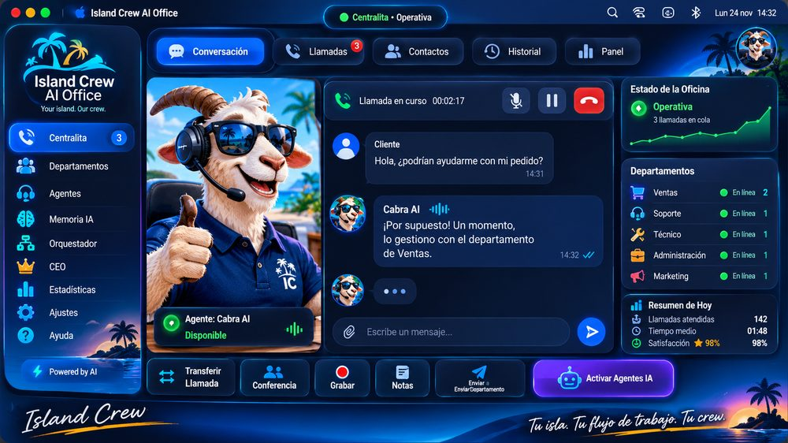


<table>
<tr>
<td width="50%"></td>
<td width="50%"></td>
</tr>
<tr>
<td colspan="2"></td>
</tr>
</table>

<sub>Hardware and marketing images are design concepts; the interface is the working software.</sub>

</div>

</details>

<details>
<summary><b>⚡ Areas of exploration & roadmap</b></summary>

<br>

| Area | Direction |
|---|---|
| Mobile | Evolve the published apps; Carbonuxis Android in QA testing |
| Desktop | Downloadable cross-platform software with one-click installers |
| AI | Useful, real integrations: voice agents, summaries, scheduling |
| Automation | Remove repetitive work, keep a human approving what matters |
| Infrastructure | Reliability, architecture, release automation |

</details>

<a id="pipeline"></a>
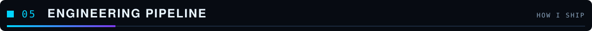

<div align="center">


</div>

<details>
<summary><b>▸ Pipeline as a diagram (Mermaid)</b></summary>

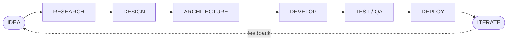

</details>

<details>
<summary><b>▸ Engineering principles</b></summary>

<br>

- **Verify, don't assume.** Every claim is tested before I report it as done.
- **Traceability.** From the NDT world: every output can be traced to its source.
- **Human in the loop.** Automation proposes; the owner approves what leaves the building.
- **Ship small, ship real.** A working release beats a perfect plan.

</details>

<a id="stack"></a>
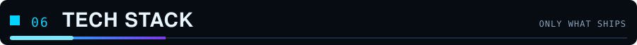

<div align="center">


</div>

<details>
<summary><b>▸ Stack as icons</b></summary>

<br>

<div align="center">

<br>
<br>


</div>

</details>

<div align="center">

<sub>Only technologies that appear in my actual repositories.</sub>

</div>

<a id="career"></a>


<details open>
<summary><b>🧬 From NDT inspector to software builder — my path</b></summary>

<br>

<div align="center">


<br>

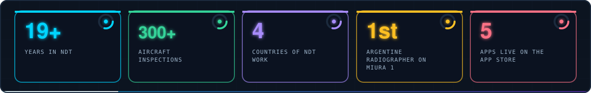

</div>

NDT has been my craft since 2007: welds, aircraft engines and rocket structures, in Argentina, Spain and Switzerland. At **PLD Space** I worked on **Miura 1** — Spain's first domestically built rocket — and became the first Argentine radiographer to perform radiographic testing on it. At **SR Technics** I carried out **300+ inspections on critical aircraft components**. About a year ago I started the transition to software: I taught myself Swift and SwiftUI and shipped **ENODEUS**, a native iOS app that automates inspection work I used to do by hand. Same discipline, new material.

- Hands-on VT, PT, MT, RT and UT across aerospace, energy and manufacturing
- Worked under EASA, EN 4179, ISO 9001 and ASME requirements: reports, non-conformities, root-cause analysis, audits
- Now: Swift, SwiftUI, Firebase and App Store compliance — the habits of shipping a real product

<div align="center">

<picture><source media="(max-width: 700px)" srcset="assets/generated/standards-n-d66a7fdd.svg">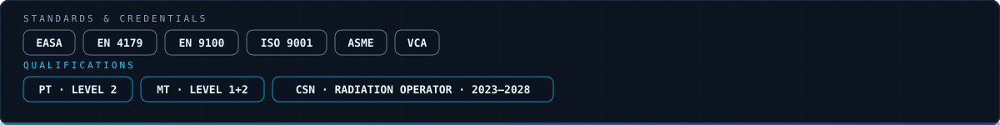</picture>

<br><br>

<picture><source media="(max-width: 700px)" srcset="assets/generated/mapping-n-7130b777.svg"></picture>

</div>

<sub>PT = liquid penetrant · MT = magnetic particle · VT = visual · RT = radiography</sub>

<div align="center">

<table>
<tr>
<td width="33%"></td>
<td width="33%"></td>
<td width="33%"></td>
</tr>
</table>

<sub>SR Technics, Zürich: fluorescent penetrant inspection of an engine component, the engine hall and the FPI line.</sub>

<table>
<tr>
<td width="25%"></td>
<td width="25%"></td>
<td width="25%"></td>
<td width="25%"></td>
</tr>
</table>

<sub>Photos from my time at PLD Space: inspecting a tank section, the workshop, and a rocket launch.</sub>

</div>

</details>

<a id="metrics"></a>
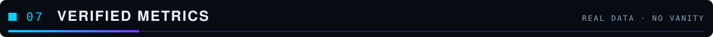

<div align="center">

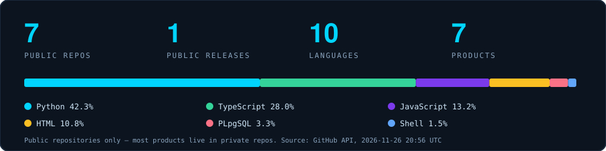

<picture><source media="(prefers-color-scheme: dark)" srcset="assets/generated/snake-dark.svg"></picture>

</div>

<details>
<summary><b>📦 Public repositories (auto-generated)</b></summary>

<br>

- [`island-crew-downloads`](https://github.com/MAXIMILIANOGROSS/island-crew-downloads) <sub>HTML · [`island-crew-suite-v1.0.0-macos`](https://github.com/MAXIMILIANOGROSS/island-crew-downloads/releases/tag/island-crew-suite-v1.0.0-macos-arm64) · 2026-11-23</sub>
- [`islandcrewsuite`](https://github.com/MAXIMILIANOGROSS/islandcrewsuite) — suite marketing <sub>Python · 2026-11-15</sub>
- [`meeting-booker-repo`](https://github.com/MAXIMILIANOGROSS/meeting-booker-repo) <sub>JavaScript · 2026-11-01</sub>
- [`MyBrain`](https://github.com/MAXIMILIANOGROSS/MyBrain) — Your second self: observes real data, proposes one action a day, waits for your approval, and learns. Free, MIT <sub>TypeScript · 2026-10-28</sub>
- [`virtual-office`](https://github.com/MAXIMILIANOGROSS/virtual-office) — Oficina virtual 3D con 43 agentes de IA. Plantilla en blanco, Next.js + Supabase. <sub>TypeScript · 2026-10-23</sub>
- [`carbon-is-android`](https://github.com/MAXIMILIANOGROSS/carbon-is-android) — carbonáis para android <sub>— · 2026-09-24</sub>
- [`island-crew-legal`](https://github.com/MAXIMILIANOGROSS/island-crew-legal) <sub>— · 2026-09-21</sub>

<sub>Last refreshed by GitHub Actions: 2026-11-27 00:19 UTC</sub>

</details>

<a id="lab"></a>
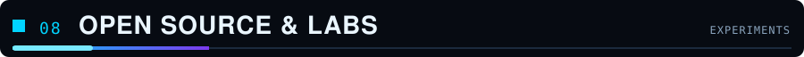


- **ENODEUS** `SaaS SUITE` — SaaS suite for companies: digitalizes processes and quality inspections for 15 industry fields. · [site](https://enodeus.ch)
- **MyBrain** `OPEN SOURCE · MIT` — A second self: observes real data, proposes one action a day, waits for approval, learns. · [repo](https://github.com/MAXIMILIANOGROSS/MyBrain)
- **Virtual Office** `OPEN SOURCE` — 3D virtual office with 43 AI agents. Blank template on Next.js + Supabase. · [repo](https://github.com/MAXIMILIANOGROSS/virtual-office)
- **Island Crew Suite** `RELEASE` — Self-installing Mac / Windows marketing suite for restaurants. Downloads published as releases. · [repo](https://github.com/MAXIMILIANOGROSS/island-crew-downloads)

<picture><source media="(max-width: 700px)" srcset="assets/generated/gravity-n-4dc86e71.svg">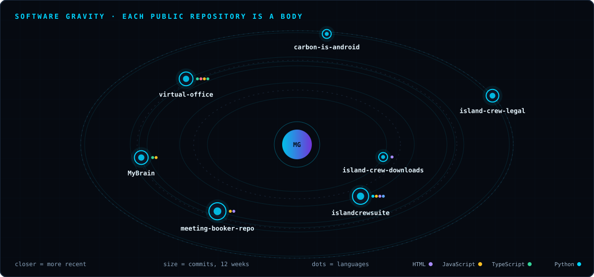</picture>

<picture><source media="(max-width: 700px)" srcset="assets/generated/devlog-n-763b0ed3.svg">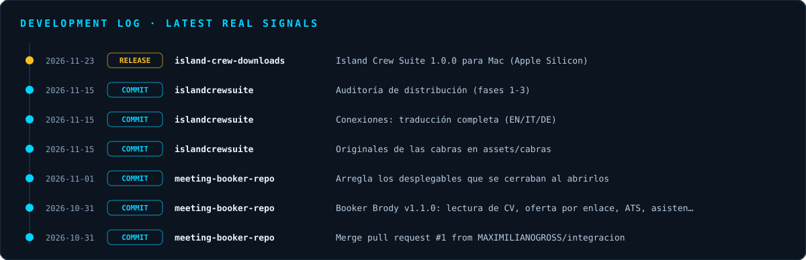</picture>

<picture><source media="(max-width: 700px)" srcset="assets/generated/telemetry-n-6914da48.svg"></picture>

<details>
<summary><b>🎧 Beyond software</b></summary>

<br>

<div align="center">

  

</div>

Music production, sound design, visual concepts and branding — including **Cabra Beats**, an AI-assisted music creation tool for business jingles and songs. Technical thinking combined with creativity.

<a href="https://www.youtube.com/@IslandCrewYT"></a> <sub>Automated channel — songs and jingles published by Cabra Beats.</sub>

</details>

<details>
<summary><code>sudo reveal_more</code></summary>

<br>

```text
[sudo] password for maximiliano: ********
Access granted.

> This profile is generated by its own scripts (scripts/build.py).
> Every number above is pulled from the GitHub API — or it isn't shown.
> Fun fact: the radar sweeps once every 12 seconds. Nobody asked, it just felt right.
> The next build is already running. Check back soon.
```

</details>

<a id="connect"></a>
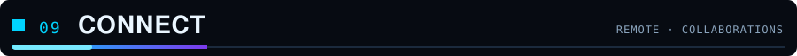

<div align="center">

**Interested in building something meaningful together?**<br>
Open to remote opportunities, software collaborations and interesting projects — Greece / EU.

<a href="https://www.linkedin.com/in/maximiliano-olmos-sanchez"></a>
<a href="https://github.com/MAXIMILIANOGROSS"></a>
<a href="https://enodeus.ch"></a>
<a href="https://islandcrew.es"></a>
<a href="https://www.youtube.com/@IslandCrewYT"></a>
<a href="https://lebenslaufy.com"></a>

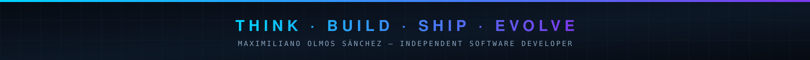

</div>


