<!-- GENERATED FILE: edit templates/README.tpl.md, scripts/i18n.py and data/*.json, then run `python3 scripts/build.py`. -->
<div align="center">

<p>🌐 <a href="README.md"></a> <a href="README.es.md"></a> <a href="README.de.md"></a> <a href="README.it.md"></a> <a href="README.fr.md"></a> <a href="README.zh.md"></a> <a href="README.ar.md"></a> </p>


<a href="#about"></a>
<a href="#products"></a>
<a href="#radar"></a>
<a href="#building"></a>
<a href="#metrics"></a>
<a href="#connect"></a>

**我把想法变成软件。**<br>
应用 · 桌面软件 · 网络平台 · AI 与自动化 —— 从概念到上线。

<sub><i>我检测过焊缝、飞机发动机和火箭。现在，我检测代码。</i></sub>

<br><br>


</div>


<a id="about"></a>
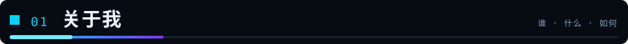

<table>
<tr>
<td width="260" valign="top" align="center">


</td>
<td valign="top">

我是独立软件开发者和产品构建者。我交付的不是零散功能，而是**完整的产品**：创意、界面、应用、后端、集成、测试、文档和发布。

我的背景是航空航天级质量：2007 年起从事无损检测，经历 **PLD Space**（Miura 1）、**Bureau Veritas** 审核和 **SR Technics** —— 因此我以*零容忍*的态度做事：可追溯、可验证、结果可复现。

</td>
</tr>
</table>

<table>
<tr>
<td width="50%" valign="top">

**我构建什么**

- 移动应用（iOS · Android）
- 桌面软件（macOS · Windows）
- 网络平台
- AI 工具与语音智能体
- 自动化与软件生态系统

</td>
<td width="50%" valign="top">

**我的工作方式**

`思考 → 设计 → 构建 → 测试 → 部署 → 改进`

独立、有文档、能交付。我通过打造真实的产品来学习。

</td>
</tr>
</table>

<details open>
<summary><b>🧬 从无损检测员到软件构建者 —— 我的路径</b></summary>

<br>

<div align="center">


<br>

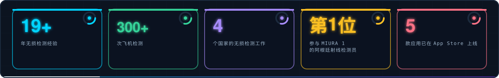

</div>

自 2007 年起，无损检测就是我的本行：焊缝、飞机发动机和火箭结构，足迹遍及阿根廷、西班牙和瑞士。在 **PLD Space**，我参与了西班牙首枚本土制造火箭 **Miura 1**，并成为第一位对其进行射线检测的阿根廷射线检测员。在 **SR Technics**，我对关键飞机部件完成了 **300 多次检测**。大约一年前，我开始转向软件：自学 Swift 和 SwiftUI，并发布了 **ENODEUS** —— 一款原生 iOS 应用，把我过去手工完成的检测工作自动化。同样的纪律，全新的材料。

- 在航空航天、能源和制造业实操 VT、PT、MT、RT 和 UT
- 依据 EASA、EN 4179、ISO 9001 和 ASME 要求工作：报告、不合格项、根因分析、审核
- 现在：Swift、SwiftUI、Firebase 与 App Store 合规 —— 交付真实产品的习惯

<div align="center">

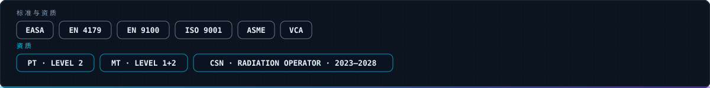

<br><br>


</div>

<sub>PT = 渗透检测 · MT = 磁粉检测 · VT = 目视检测 · RT = 射线检测</sub>

<div align="center">

<table>
<tr>
<td width="33%">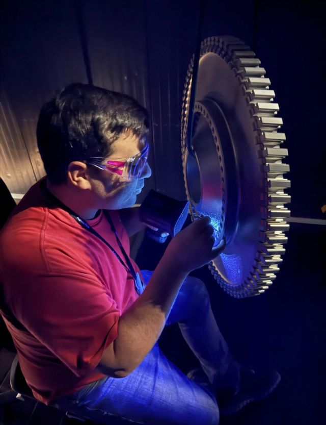</td>
<td width="33%">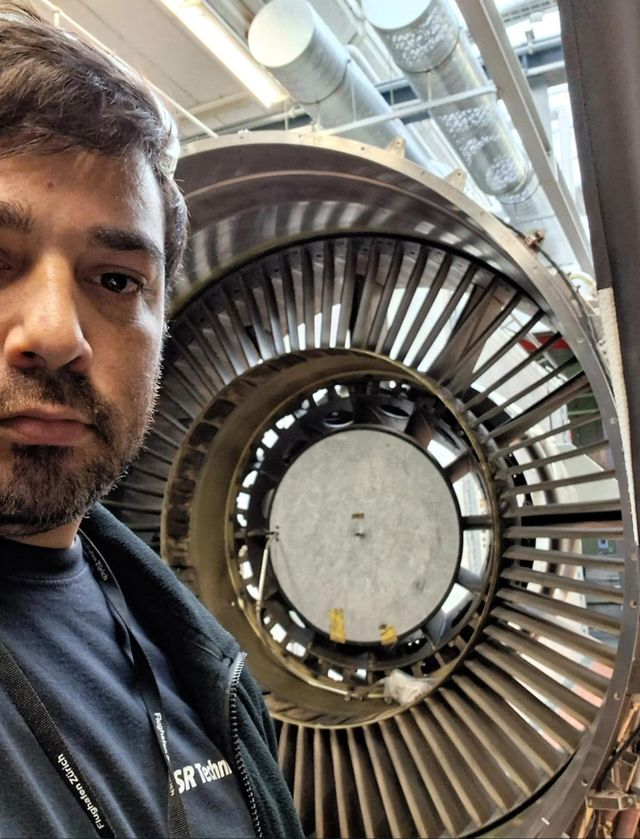</td>
<td width="33%"></td>
</tr>
</table>

<sub>SR Technics，苏黎世：发动机部件的荧光渗透检测、发动机车间和 FPI 检测线。</sub>

<table>
<tr>
<td width="25%"></td>
<td width="25%"></td>
<td width="25%"></td>
<td width="25%"></td>
</tr>
</table>

<sub>我在 PLD Space 期间的照片：检查储箱段、车间和一次火箭发射。</sub>

</div>

</details>

<details open>
<summary><b>🌐 Island Crew 生态系统 —— 人才、AI 办公室、餐厅、学院、媒体</b></summary>

<br>

<div align="center">


<sub>服务加那利群岛的人、企业与创新的一体化生态 —— Maxi OS 统筹由 60 个智能体、16 个部门组成的 AI 办公室。</sub>

</div>

</details>


<a id="products"></a>
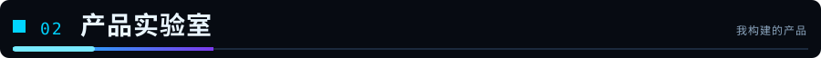

<div align="center">

<table>
<tr>
<td width="50%" valign="top">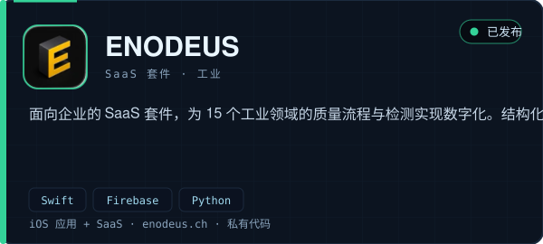<br><a href="https://enodeus.ch"><b>打开 Enodeus →</b></a></td>
<td width="50%" valign="top">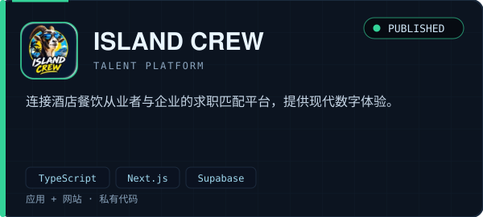<br><a href="https://islandcrew.es"><b>打开 Island Crew →</b></a></td>
</tr>
<tr>
<td width="50%" valign="top">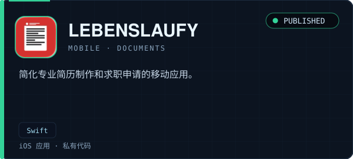<br><a href="https://lebenslaufy.com"><b>打开 Lebenslaufy →</b></a></td>
<td width="50%" valign="top">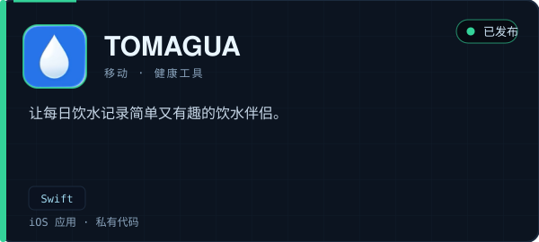<br><sub>私有代码</sub></td>
</tr>
<tr>
<td width="50%" valign="top">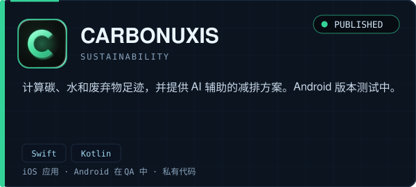<br><sub>私有代码</sub></td>
<td width="50%" valign="top">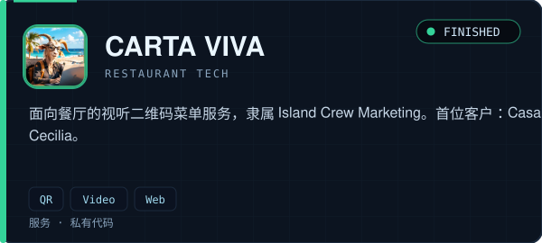<br><sub>私有代码</sub></td>
</tr>
<tr>
<td width="50%" valign="top">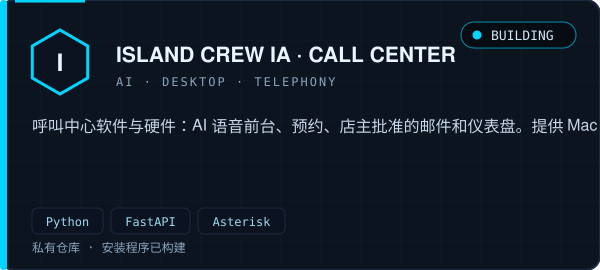<br><sub>私有代码</sub></td>
</tr>
</table>

<details open>
<summary><b>📱 App Store 上 —— 我已发布的 iPhone 和 iPad 应用</b></summary>

<br>


</details>

<sub>状态标签是真实的：它们来自 <code>data/projects.json</code>。“私有代码”表示产品存在，但源代码未公开。</sub>

</div>

<a id="radar"></a>
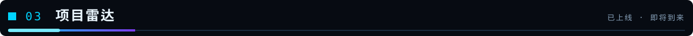

<div align="center">


</div>


<a id="building"></a>
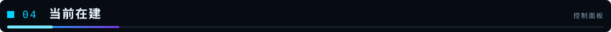

<div align="center">


</div>

**Island Crew IA — 呼叫中心软件与硬件。** 带 AI 语音前台的电话总机：接听来电、预约、起草需经店主批准的客户邮件，并通过仪表盘汇报。提供 macOS 和 Windows 安装程序。

<details>
<summary><b>📸 总机图库 —— 界面、硬件概念与宣传</b></summary>

<br>

<div align="center">


<table>
<tr>
<td width="50%"></td>
<td width="50%"></td>
</tr>
<tr>
<td colspan="2"></td>
</tr>
</table>

<sub>硬件和宣传图为设计概念；界面是可运行的真实软件。</sub>

</div>

</details>

<details>
<summary><b>⚡ 探索方向与路线图</b></summary>

<br>

| 领域 | 方向 |
|---|---|
| 移动端 | 持续迭代已发布的应用；Carbonuxis Android 处于 QA 测试 |
| 桌面 | 可下载的跨平台软件，一键安装 |
| AI | 实用、真实的集成：语音智能体、摘要、日程 |
| 自动化 | 消除重复工作，关键事项由人批准 |
| 基础设施 | 可靠性、架构、发布自动化 |

</details>

<a id="pipeline"></a>
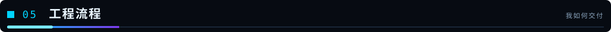

<div align="center">


</div>

<details>
<summary><b>▸ 流程图（Mermaid）</b></summary>

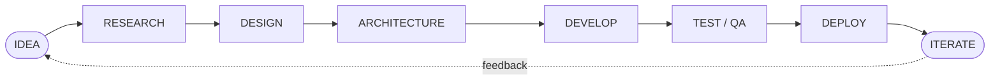

</details>

<details>
<summary><b>▸ 工程原则</b></summary>

<br>

- **验证，而非假设。** 每个结论都先测试，再宣布完成。
- **可追溯。** 源自无损检测领域：每个输出都能追溯到来源。
- **人在回路。** 自动化提出建议；店主批准对外发出的内容。
- **小步发布，真实交付。** 一个可用的版本胜过完美的计划。

</details>

<a id="stack"></a>
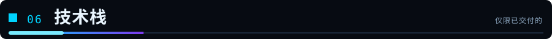

<div align="center">


</div>

<details>
<summary><b>▸ 技术栈图标</b></summary>

<br>

<div align="center">

<br>
<br>


</div>

</details>

<div align="center">

<sub>仅列出我真实仓库中出现的技术。</sub>

</div>

<a id="metrics"></a>
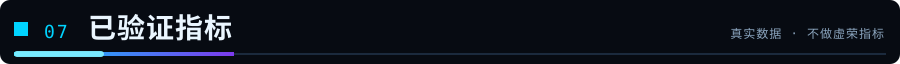

<div align="center">

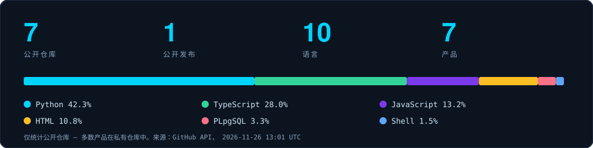

<picture><source media="(prefers-color-scheme: dark)" srcset="assets/generated/snake-dark.svg"></picture>

</div>

<details>
<summary><b>📦 公开仓库（自动生成）</b></summary>

<br>

| Repository | What it is | Language | Latest release | Updated |
|---|---|---|---|---|
| [`island-crew-downloads`](https://github.com/MAXIMILIANOGROSS/island-crew-downloads) | island-crew-downloads | HTML | [island-crew-suite-v1.0.0-macos-arm64](https://github.com/MAXIMILIANOGROSS/island-crew-downloads/releases/tag/island-crew-suite-v1.0.0-macos-arm64) | 2026-11-23 |
| [`islandcrewsuite`](https://github.com/MAXIMILIANOGROSS/islandcrewsuite) | suite marketing | Python | — | 2026-11-15 |
| [`meeting-booker-repo`](https://github.com/MAXIMILIANOGROSS/meeting-booker-repo) | — | JavaScript | — | 2026-11-01 |
| [`MyBrain`](https://github.com/MAXIMILIANOGROSS/MyBrain) | Your second self: observes real data, proposes one action a day, waits for your approval, and learns. Free, MIT | TypeScript | — | 2026-10-28 |
| [`virtual-office`](https://github.com/MAXIMILIANOGROSS/virtual-office) | Oficina virtual 3D con 43 agentes de IA. Plantilla en blanco, Next.js + Supabase. | TypeScript | — | 2026-10-23 |
| [`carbon-is-android`](https://github.com/MAXIMILIANOGROSS/carbon-is-android) | carbonáis para android | — | — | 2026-09-24 |
| [`island-crew-legal`](https://github.com/MAXIMILIANOGROSS/island-crew-legal) | — | — | — | 2026-09-21 |

<sub>GitHub Actions 最近更新： 2026-11-26 19:16 UTC</sub>

</details>

<a id="lab"></a>
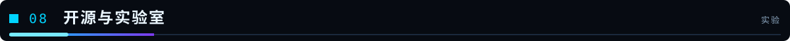

| 项目 | 状态 | 简介 | |
|---|---|---|---|
| **ENODEUS** | `SaaS 套件` | 面向企业的 SaaS 套件：为 15 个工业领域的流程与质量检测实现数字化。 | [网站](https://enodeus.ch) |
| **MyBrain** | `开源 · MIT` | 第二个自己：观察真实数据，每天提出一项行动，等待批准并持续学习。 | [仓库](https://github.com/MAXIMILIANOGROSS/MyBrain) |
| **Virtual Office** | `开源` | 拥有 43 个 AI 智能体的 3D 虚拟办公室。基于 Next.js + Supabase 的空白模板。 | [仓库](https://github.com/MAXIMILIANOGROSS/virtual-office) |
| **Island Crew Suite** | `发行版` | 面向餐厅的 Mac / Windows 自安装营销套件。下载以 release 形式发布。 | [仓库](https://github.com/MAXIMILIANOGROSS/island-crew-downloads) |

<details>
<summary><b>🎧 软件之外</b></summary>

<br>

<div align="center">

  

</div>

音乐制作、声音设计、视觉概念与品牌 —— 包括 **Cabra Beats**，一款面向企业广告歌和歌曲的 AI 辅助音乐创作工具。技术思维与创造力结合。

<a href="https://www.youtube.com/@IslandCrewYT"></a> <sub>自动化频道 —— 由 Cabra Beats 发布的歌曲和广告歌。</sub>

</details>

<details>
<summary><code>sudo reveal_more</code></summary>

<br>

```text
[sudo] password for maximiliano: ********
Access granted.

> This profile is generated by its own scripts (scripts/build.py).
> Every number above is pulled from the GitHub API — or it isn't shown.
> Fun fact: the radar sweeps once every 12 seconds. Nobody asked, it just felt right.
> The next build is already running. Check back soon.
```

</details>

<a id="connect"></a>
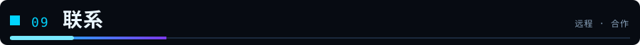

<div align="center">

**想一起做点有意义的事吗？**<br>
欢迎远程工作机会、软件合作和有趣的项目 —— 希腊 / 欧盟。

<a href="https://www.linkedin.com/in/maximiliano-olmos-sanchez"></a>
<a href="https://github.com/MAXIMILIANOGROSS"></a>
<a href="https://enodeus.ch"></a>
<a href="https://islandcrew.es"></a>
<a href="https://www.youtube.com/@IslandCrewYT"></a>
<a href="https://lebenslaufy.com"></a>

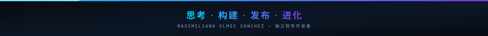

</div>


