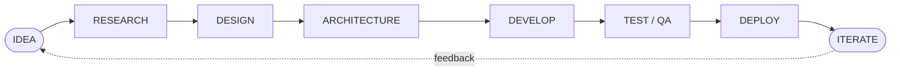

<!-- GENERATED FILE: edit templates/README.tpl.md, scripts/i18n.py and data/*.json, then run `python3 scripts/build.py`. -->
<div align="center">

{{LANGBAR}}


{{NAV}}

**{{t.t1}}**<br>
{{t.t2}}

<sub><i>{{t.sig}}</i></sub>

<br><br>


</div>

{{DIR_OPEN}}

<a id="about"></a>


<table>
<tr>
<td width="260" valign="top" align="center">


</td>
<td valign="top">

{{t.about1}}

{{t.about2}}

</td>
</tr>
</table>

<table>
<tr>
<td width="50%" valign="top">

**{{t.what_h}}**

{{t.what_li}}

</td>
<td width="50%" valign="top">

**{{t.how_h}}**

`{{t.how_flow}}`

{{t.how_p}}

</td>
</tr>
</table>

<details open>
<summary><b>{{t.pld_sum}}</b></summary>

<br>

<div align="center">


<br>


</div>

{{t.pld_p}}

{{t.pld_li}}

<div align="center">


<br><br>


</div>

<sub>{{t.pld_legend}}</sub>

<div align="center">

<table>
<tr>
<td width="33%"></td>
<td width="33%"></td>
<td width="33%"></td>
</tr>
</table>

<sub>{{t.sr_cap}}</sub>

<table>
<tr>
<td width="25%"></td>
<td width="25%"></td>
<td width="25%"></td>
<td width="25%"></td>
</tr>
</table>

<sub>{{t.pld_cap}}</sub>

</div>

</details>

<details open>
<summary><b>{{t.eco_sum}}</b></summary>

<br>

<div align="center">


<sub>{{t.eco_cap}}</sub>

</div>

</details>


<a id="products"></a>


<div align="center">

{{GRID}}

<details open>
<summary><b>{{t.store_sum}}</b></summary>

<br>


</details>

<sub>{{t.status_note}}</sub>

</div>

<a id="radar"></a>


<div align="center">


</div>


<a id="building"></a>


<div align="center">


</div>

{{t.call_p}}

<details>
<summary><b>{{t.gal_sum}}</b></summary>

<br>

<div align="center">


<table>
<tr>
<td width="50%"></td>
<td width="50%"></td>
</tr>
<tr>
<td colspan="2"></td>
</tr>
</table>

<sub>{{t.gal_note}}</sub>

</div>

</details>

<details>
<summary><b>{{t.road_sum}}</b></summary>

<br>

{{t.road_tbl}}

</details>

<a id="pipeline"></a>


<div align="center">


</div>

<details>
<summary><b>{{t.pipe_sum}}</b></summary>



</details>

<details>
<summary><b>{{t.prin_sum}}</b></summary>

<br>

{{t.prin}}

</details>

<a id="stack"></a>


<div align="center">


</div>

<details>
<summary><b>{{t.icons_sum}}</b></summary>

<br>

<div align="center">

<br>
<br>


</div>

</details>

<div align="center">

<sub>{{t.stack_note}}</sub>

</div>

<a id="metrics"></a>


<div align="center">


{{SNAKE}}

</div>

<details>
<summary><b>{{t.repos_sum}}</b></summary>

<br>

{{REPOS}}

<sub>{{t.refreshed}} {{UPDATED}}</sub>

</details>

<a id="lab"></a>


{{t.lab_hdr}}
{{LAB}}

<details>
<summary><b>{{t.beyond_sum}}</b></summary>

<br>

<div align="center">

  

</div>

{{t.beyond_p}}

<a href="https://www.youtube.com/@IslandCrewYT"></a> <sub>{{t.yt_note}}</sub>

</details>

<details>
<summary><code>sudo reveal_more</code></summary>

<br>

```text
[sudo] password for maximiliano: ********
Access granted.

> This profile is generated by its own scripts (scripts/build.py).
> Every number above is pulled from the GitHub API — or it isn't shown.
> Fun fact: the radar sweeps once every 12 seconds. Nobody asked, it just felt right.
> The next build is already running. Check back soon.
```

</details>

<a id="connect"></a>


<div align="center">

**{{t.c_q}}**<br>
{{t.c_p}}

<a href="{{LINKEDIN}}"></a>
<a href="https://github.com/{{OWNER}}"></a>
<a href="{{SITE}}"></a>
<a href="https://islandcrew.es"></a>
<a href="https://www.youtube.com/@IslandCrewYT"></a>
<a href="https://lebenslaufy.com"></a>


</div>

{{DIR_CLOSE}}
